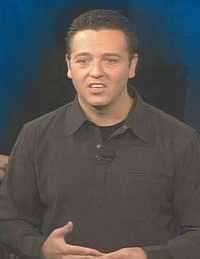

John Edward es un pseudo médium que tiene un programa en la TV norteamericana llamado *Crossing Over*. Ya lleva un tiempo en el aire y recientemente a llegado a la TV nacional como *'Cruzando al más allá con John Edward'*, por la cadena CableVision, en el canal de cable People & Arts.

Básicamente habla con el publico y hace de interlocutor entre ellos y algún ser amado en el más allá. El problema es que realmente intenta venderle a la gente que es un 'verdadero' médium, y lo que hace es un truco de magia. Sin embargo a creado mucho revuelo entre la gente que quiere creer, la gente que no cree y a la que le importa un pepino.

Como muchos otros antes que el se aprovecha de la gente más sensible e impresionable, y se defiende detrás de una fachada de integridad y de un deseo de 'ayudar'. Poco se puede decir para 'contraatacar' este tipo de discurso que no provoque una encarnizada discusión, ya que el problema no pasa tanto por una diferencia de opiniones sino más por un falso razonamiento. Sin embargo escuche el mejor contra-argumento en el capítulo 94 de la 6º temporada de South Park (que excelente programa!), llamado The Biggest Douche in the Universe ('douche' significa 'lavado vaginal' en ingles, 'You are a douche' seria lo mismo que 'Sos un pene', asiendo alusión a la carencia de brillantez mental). A continuación la trascripción traducida de la conversación de John Edwards cuando este es confrontado por Stan que le reclama que este engañando a su mejor amigo haciéndole creer que habla con su recientemente fallecida abuela.

> Stan: Solo te digo esto, John Edward. Sos un mentiroso, un estafador, y el pene más grande del mundo. John Edward: Todo lo que le digo a la gente es positivo y les da Esperanza! ¿Cómo va eso a convertirme en un pene? Stan: Porque las grandes preguntas de la vida son difíciles: ¿Por qué estamos aquí? ¿De dónde venimos? ¿A dónde vamos?. Pero si la gente le cree a un pene como vos, nunca vamos a encontrar la respuesta real a estas preguntas. No solo sos un mentiroso, estas retrasando el progreso de toda la humanidad, sos un pene!

Sencillamente magnífica. Así que cada ves que me encuentre en medio de una discusión del tipo esotérico y me quieran acorralar con el viejo truco de '¿qué mal le hago?' ya voy a saber que contestar, y ustedes tambien!

No podia dejar de transcribir algunas de los otros geniales intercambios verbales entre Stan y John Edward:

> John Edward: Pero yo soy psiquico.
>
> Stan: No pibe, sos un pene.
>
> John Edward: No soy un pene! ¿Qué pasa si realmente
>
> creo que los muertos hablan con migo?
>
> Stan: Entonces sos un pene estúpido.

Y una más, la ultima reflexión del capitulo.

> Stan: No, no quiero hablar con vos. Quiero hablar con la audiencia. John Edward: Eh? ¿Por qué?... Stan: Gente. Al principio creía que ustedes eran entupidos por escuchar los consejos de este pene.
>
> Pero ahora entiendo que vinieron para encontrar
>
> respuestas a sus problemas. Ustedes creen que hay gente flotando alrededor tratando de comunicarse,
>
> yo se que realmente lo creen. Pero piensen en esto,
>
> ¿es eso lo que desean? Tener que morir y flotar por
>
> ahí, ¿hablando con este pene? Tenemos que
>
> reconocerlo por lo que es, un truco de magia, porque la realidad de la vida es más sorprendente que este pene.
