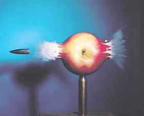
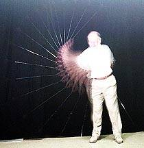

Siempre me ha maravillado las fotos de alta velocidad, el mundo visto en un pestañeo. Hay cosas realmente increíbles ocurriendo ante nosotros pero demasiado rápido para apreciarlas. Uno de los pioneros en este campo fue el señor [Edgerton](https://edgerton.org/).

Ahora, para poder tomar este tipo de fotos necesitamos una cámara de alta velocidad, pero solo cuento con una cámara digital. Además me es imposible sincronizar la foto con algún movimiento pues las cámaras digitales tardan algunos segundos en tomar las fotos, así que mi mejor opcion es utilizar una luz estroboscopica. Sin embargo este tipo de luces son muy caros, así que buscando por internet conseguí una muy buena opción, una luz estroboscopica mecánica \[[stroboscope-1.jpg](/assets/blog/legacy/stroboscope-1.jpg)\].

La idea es cortar un disco de cartón negro y hacerle una ranura de unos dos centímetros (como si una porción de pizza se tratara). Luego le agregamos un pequeño motor eléctrico al centro del disco \[[stroboscope-2.jpg](/assets/blog/legacy/stroboscope-2.jpg)\]. Finalmente colocamos el disco delante de la lente de la cámara \[[stroboscope-3.jpg](/assets/blog/legacy/stroboscope-3.jpg)\].

Con esto listo solo queda iluminar aquello que queremos fotografiar, cuidando que halla un fondo negro (o lo menos luminoso posible, no queremos quemar la foto), y setear la cámara digital para que tome una foto con aproximadamente dos a 5 segundos de exposición (según lo que queramos fotografiar). El resultado deberia verse algo asi:

Más info en: <https://www.davidhazy.org/andpph/text-stroboscope.html>
