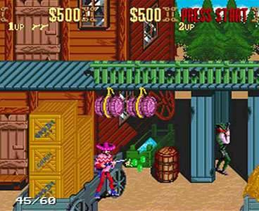
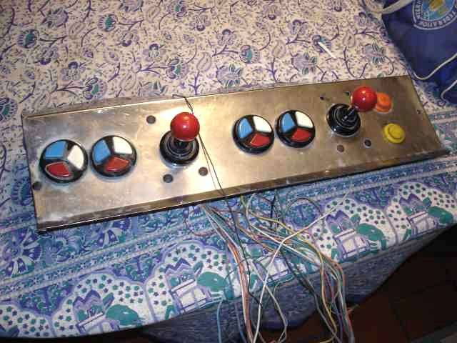
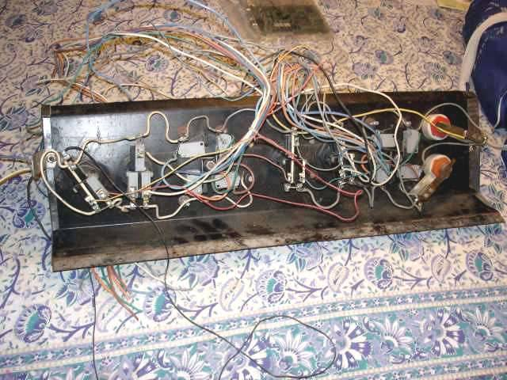
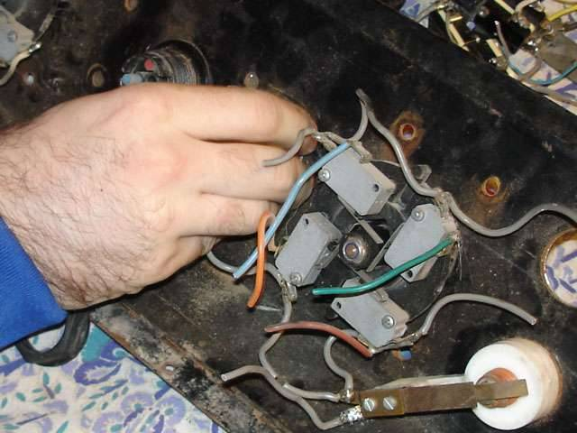
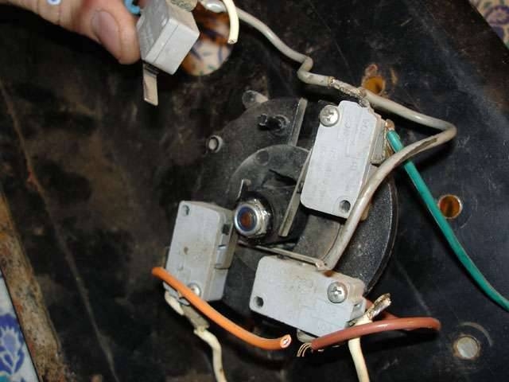
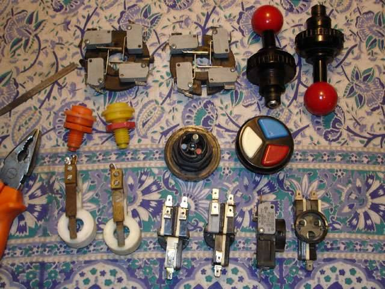
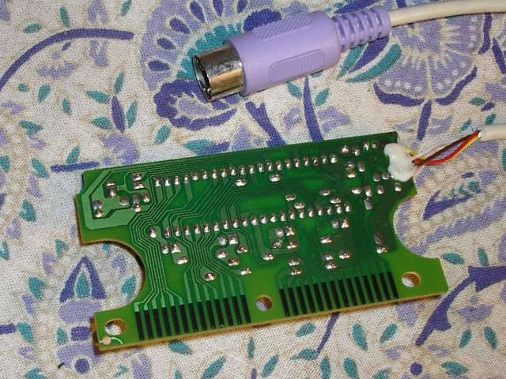
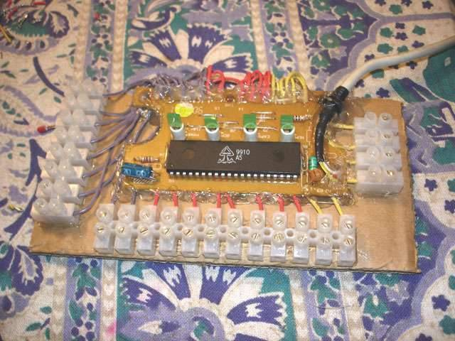
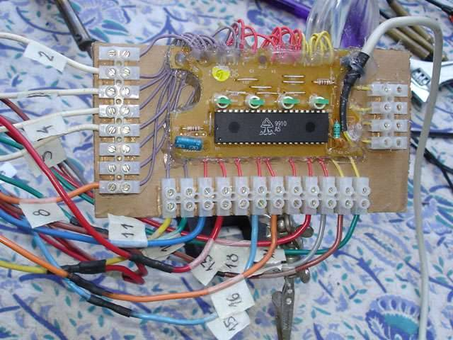
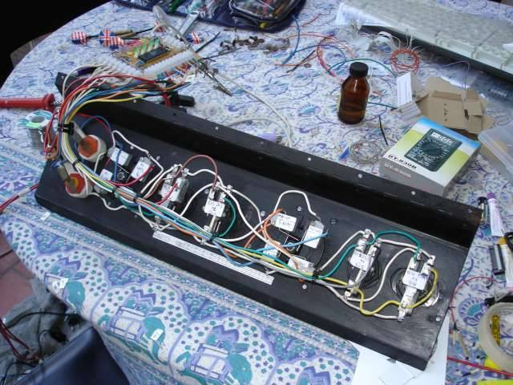

Hace unas semanas un amigo se me acerco y me comento que había comprado un viejo Arcade, un *fichín* como los de Saccoa, con su televisor, los joysticks y la caja de fichas, todo en una cómoda estructura de madera del tamaño de una heladera. Incluso funcionaba, y tenia el juego Sunset Riders, uno de baqueros que seguro más de uno jugo alguna vez.

Actualmente se pueden jugar practicamente todos los juegos de Arcade en una PC de escritorio usando un emulador como el [Mame](http://www.mame.net/). Pero buscabamos reproducir el tipo de experiencia *codo a codo* que solo un fichín puede darnos.

Sin embargo hay un aspecto de dificil solución: los joystics. Estrictamente hablando las palancas y botones que encontramos en nuestro fichin no son Joystics, no hay manera de conectarlos directamente a la PC.

Hay varias soluciones, analizadas y comparadas en esta guia paso a paso de [Build Your Own Arcade Controls FAQ](http://arcadecontrols.com/arcade_input.shtml). La que mejor se ajustaba a mis posibilidades económicas -no pienso poner un peso- y disponibilidad de materiales -quien no tiene un teclado tirado por ahí- era adaptar un teclado. Si bien la solución más obvia es adaptar un joystic para PC, lamentablemente solo funcionaría para un solo jugador. El problema esta en que un puerto de joystic solo admite 12 señales (a menos que las codifique como lo hacen los joystics modernos pero lamentablemente solo funcionan con windows y no con el Mame que corren bajo DOS) y para dos jugadores nesesitariamos al menos 8 señales para los controles (un par de: arriba, abajo, derecha e izquierda) y otras 6 para darle a cada jugador por lo menos 3 botones. Pero hay un periferico que si soporta suficientes señales. y es el teclado, lo cual nos lleva al tema de este blog, el llamado **Keyboard Hack**.

\
**Construcción**

Basicamente soldamos los controles del fichin a la electrónica de un viejo teclado. Todas las PC soportan los teclados y lo que es mejor, contamos con muchísimas más señales disponibles que en un joystik, lo cual nos permite reservar teclas para detectar cuando el usuario incerta una moneda, los botones de jugador 1 y 2, e incluso proporcinarle a cada jugador 6 botones de accion, ademas de los 4 del joystick.

Asi que comensamos el proyecto. Primero desmontamos la bandeja de controles del fichin para trabajarla por separado, estaba bastante sucia y toscamente soldada.

Con ayuda de Fede -feliz dueño del fichin- logramos desatornillar los controles para limpiarlos, y poder pintar por separado la dañada superficie de la bandeja.

Nunca antes habia visto un fichin desde este punto, y me sorprendio lo sencillo de los controles, simplemente usa interruptores, uno por cada boton, y uno por cada direccion.

Asi se veian luego de restaurarlos, y retirado los restos de soldadura.

Bien, para realizar nuestro *adaptador* de teclado, necesitamos un teclado, pero solo el componente electronico, no las teclas de plastico.

Luego de bastante trabajo de soldaduro, verificación con un multímetro, y un poco de pegamento, monte la placa de sircuitos sobre un carton y solde los contactos a una hilera de borneras eléctricas para que el proyecto quedara más ordenado, y fácil de desmontar si fuera necesario.

Ahora biene la parte complicada. Los teclado no tienen un contacto por cada letra, sino que estan diseñados para escribir de a una sola letra por vez, como mucho 5 o 6 teclas precionadas simultaneamente. Asi que hay que identificar qué combinación de contactos crean cada letra. Este *matrix* nos permitira identificar la mejor combinacion de teclas para los dos jugadores de forma que si ambos jugadores precionan un boton al mismo tiempo, este no se vea bloqueado.\
Es algo complicado de explicar, pero en [EmuAdvice](http://www.mameworld.net/emuadvice/keyhack.html) encontre una de los mejores tutoriales sobre este hack.

Una vez elejidas las teclas, el resto fue más fácil... de decidir, porque en lo que respecta a soldar me pase como 4 horas cableando correctamente todos los controles.

Asi se veia el proyecto ensamblado.

\
**Conclusion**

Finalmente lo probamos en varias PC y funciona a las mil maravillas, las teclas estan correctamente mapeadas y elejidas y no encontramos ningun efecto de blockeo o key ghosting. En resumen un éxito.

Una ultima consideración. Muchos de los más modernos juegos de lucha corren en plataformas como el NeoGeo, el cual tiene su propio emulador. A diferencia del Mame, el emulador de NeoGeo detecta joystics con conección por USB, asi que es posible conectar en una sola PC tantos controles como queramos y en lugar de cablear los controles del fichin a la electronica de un teclado, podemos cablearlo a la electronica de varios de estos joystics.\
Esto daria muchísimos mejores resultadosm en aspectos como la velocidad, sin mencionar que no necesitamos mapear teclas ni preocuparnos por key ghosting.

Sera para el próximo fichin.
