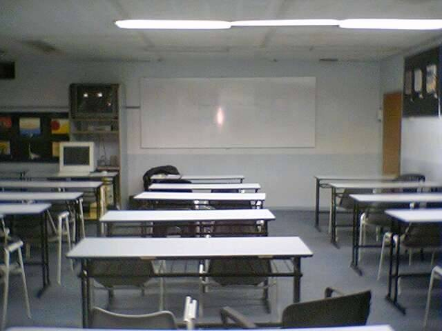
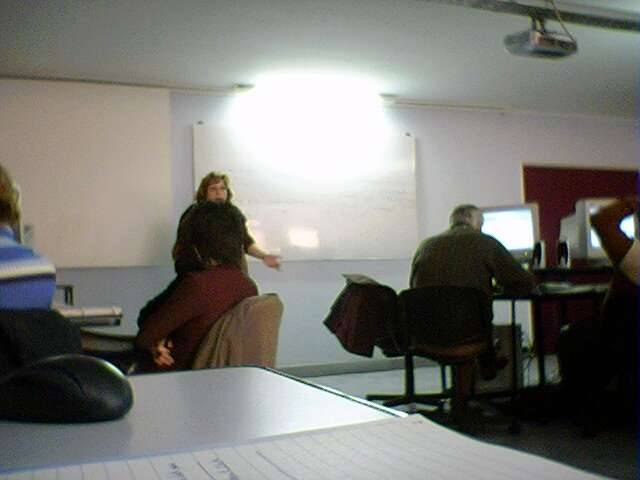

Primer dia de clase y llegue tan temprano que me comi 35 minutos en la puerta muerto de frio, al menos me entretengo escribiendo este post.

Casi me pierdo la clase, ya me parecia que llegaban todos tarde. Ahora que hay dos edificios algunas clases son en el nuevo. El viejo se veia igual que siempre, me encanto, fue como volver al hogar.

\
*Una vista del aula de diseño grafico, tal como la recordaba.*

\
Ahora tengo Visual. A ver si la profe se acuerda de mi, o mejor no, me parece que la ultima vez le rompi un poco las bolas con mis programas un poco extensos.

\
*Una toma de la clase de visual. La profe se acordaba de mi :)*

Finalmente el dia fue agotador. Tendra que ver el echo de haber dormido solo 3 horas?...

Ahora -mientras escribo este post en el subte- voy a TKD. Estoy agotado, pero contento. Mas adeante seguire blogeando mis aventuras en la facultad.
