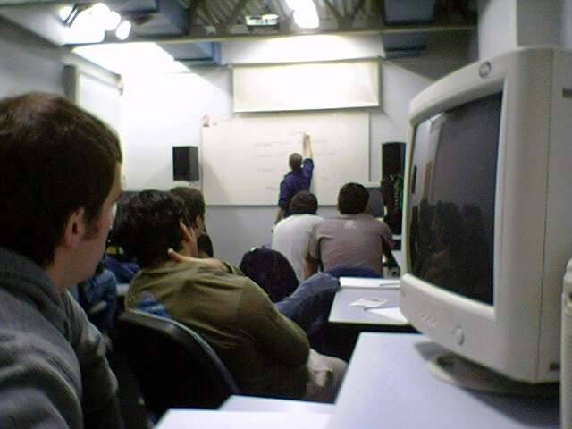
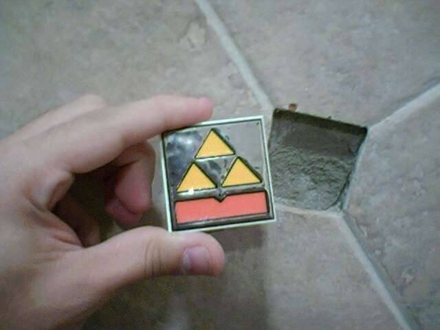
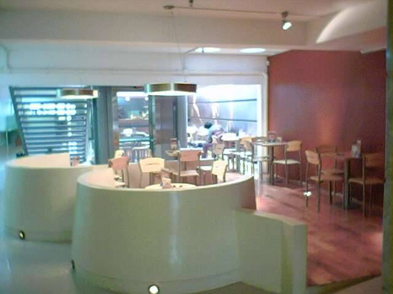

Primer lunes de clases. La primeria materia Sonido. Excelente clase. El profesor -Sebastian Miraglia- hiso incapie en conocer los principios *tras* los programas, y no casarse con ningun soft.

\
*-Imagen de la clase de Sonido-*

En el intermedio, una visita al tocador revelo la apresurada colocacion de la mamposteria.\

La clase de dibujo resulto que se trata de las tecnicas de proyeccion, que yo vi en 1ro, pero mis compañeros no. Vamos todavia, aun vengo adelantado.

Mientras escribo, aguardo un pancho en el bar.

Voy a aprovechar y terminar la web de TKD mientras aguardo a la clase de Diseño I. Creo que es con Arnau. Se acordara del juego que diseñamos tom y yo? Veremos... ;)

Arnau me reconocio y en un primer momento no entendia que asi en su clase, por mis notas :)\
Como yo vengo s cursar esta unica clase, llegue a tiempo, el resto del curso se demoro casi 30 minutos. Esto nos dio tiempo de charlar un poco... en resumen me insto a traer mis viejos trabajos -junto con lo nuevos- pra mostrarlos en clase. Hoy tenin una cara de desorientados... jua! Ya me pongo escrobir mi momografia, este año no me pasa lo del otro, que nos quedamos solos en el grupo.

\[palm:Blogged\]
