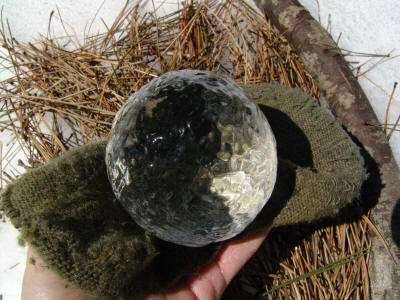
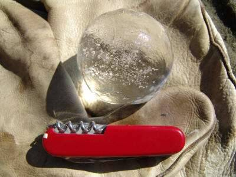
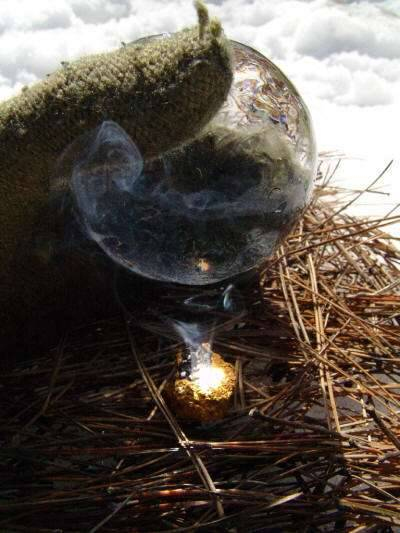

La habilidad de crear fuego puede ser la diferencia entre la vida y l muerte. Pero no siempre contamos con fosforos, encendedores u otros medios a los que tan acostumbrados estamos. Encontre en la página de\
[TrackerTrail.com](http://www.trackertrail.com/survival/fire/ice/rb/rbfirefromice3.html) una forma genial de obtener fuego con un pequeño pedazo de hielo y el sol.

La idea es construir una lente lo suficientemente transparente y capas de concentrar la luz del sol que sea posible. En la página, el autor, luego de intentar con varios modelos llego a la conclución de que el esferico era el mejor.

Personalmente me parece el más facil de construir. Ademas de la simplicidad de materiales -siempre pensando en invierno, que es ademas la epoca donde el fuego es más necesario-, y la elegancia del diseño, me parecieron dignos de remarcar. Un poco de hielo, y una cortapluma. Y funciona!

