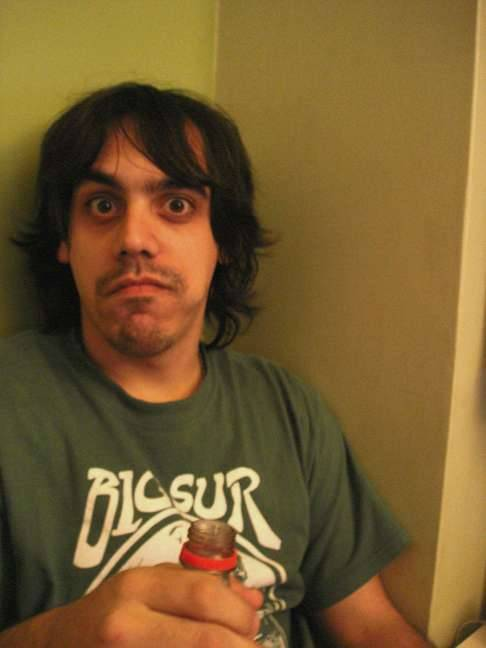

Desde el miercoles pasado eh estado trabajando contra reloj en dos proyectos muy importantes para mi. La precentacion y contenidos de el CD de Taekwon-Do y el video para el congreso de Psicoterapias al que mi mamá va a exponer con su grupo.

No puedo explicar lo agotador que esto ha sido. No solo en el aspecto tecnico ni sno tambien en lo referente a la mente. Bastante dificil es editar 4 horas de video en 40 minutos, más aun es el editar psicología.... y luego de dormir 6 horas en 3 días, les aseguro que es muy agotador. La falta de sueño, la presión, el tiempo que se va, la mala alimentación.... todo contribuye a un estado de empobrecimiento fisico y mental. Sin mencionar que sufri todos los contratiempos posibles.

Por suerte -o por pedio del trabajo duro- todo se entrego a tiempo. El CD ya esta, pero por supuesto no pude asistir a la reunion anual de Taekwon-Do donde se entrego a los más de 130 alumnos de nuestra escuela. Por lo menos se que presentaron a todos los directivos, incluyendo a Tomas como director de diseño y comunicaciónes y a mí como sub director de diseño y comunicaciones, y aplaudieron por mi ausencia. Me siento como El corredor nmascarado X -"Yo soy tu hermano!"- que todos lo vieron alguna vez pero nadie sabe quien es.\
Y pase todo el dia siguiente preparando el vide de psicoterapias, que tambien fue un exito.

\
\
*Como pueden ver estoy demacrado luego de varios días de trabajo.*

Ahora es tiempo de retomar la facultad y taekwon-do, ya que tengo pensado entrenar con Tomas para el examen de cinturon negro. Pero hoy me voy a dormir bien temprano, eso si. :)
