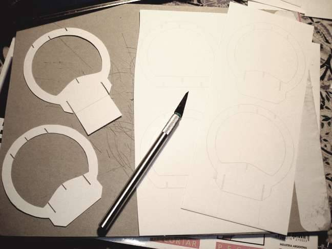
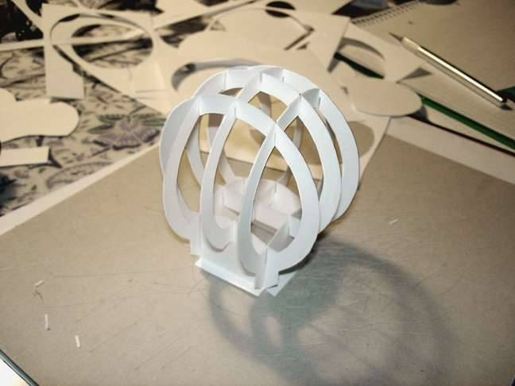
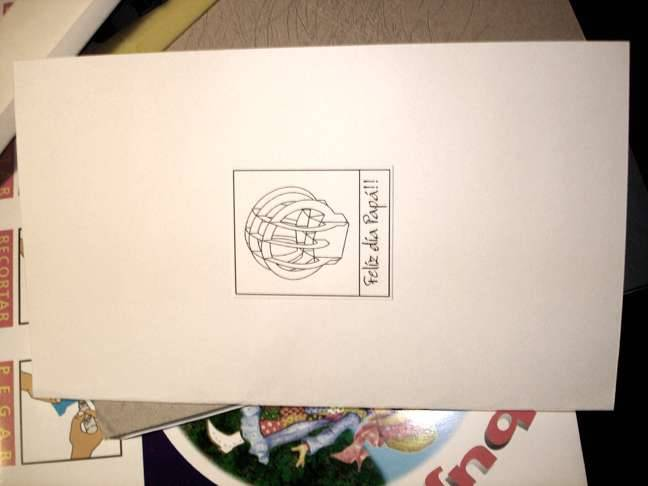
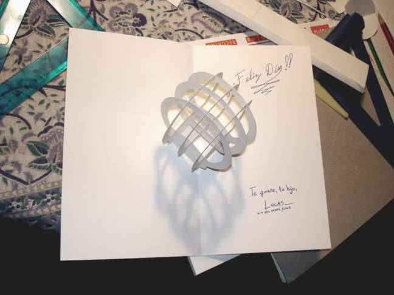

El otro día estube pensando un regalo para el cumpleaños de mi viejo, y queria darle algo lindo, interesante, algo que probocara curiosidad, pero sencillo y -por que no- barato, no solo por ahorrarme unos pesos, sino porque no hay buenos regalos en las tiendas, y las cosas que son medianamente interesantes son más que medianamente caras. Asi que me propuse buscar algo que demostrara que me imortaba. Asi fue que se me ocurrio armar un modelo de origami.

El origami es un hobby que tengo, Hay muchas cosas que se pueden construir con origami. Y en este caso me decidi por una tarjeta pop-up de 180 gados.Basicamente se trata de una de esas tarjetas que al abrirlas se despliega un modelo en tres dimensiones, y en este caso la tarjeta se debe habrir completamente, hasta 180 grados.

Lamentablemente no pude encontrar ningun modelo ni patron minimamente adecuado en internet, solo di con una foto de un modelo que me gusto muchisimo por su "simplicidad". Me las arregle para hacer un poco de ingenieria inversa en el modelo y pude contruir un patron funcional basado en esa foto. Pueden bajar el patron desde aquí: [SnowGlobe.zip](/assets/blog/legacy/snowglobe.zip).

Luego de un par de horas de dibujo en CorelDRAW, tenia listo mi patron y comence a cortarlo.

Una vez que quedo armado el modelo se vei muy bien. Ademas por la forma en que encajan las piezas una dentro de la otra el modelo se sostenia por sí mismo.

Como decoración dibujo el modelo en perspectiva para imprimirlo en la tarjeta, a modo de sello. Creo que quedo muy elegante.

Finalmente pueden ver la tarjeta finalizada en esta imagen, donde ya esta pegada en la tarjeta ya avierta.

A mi viejo le gusto muchísimo y es una suerte porque me tomo unas buenas 5 horas de investigación, desarroyo y construcción. Esta de más decir que lo disfrute muchísimo, no? :)
