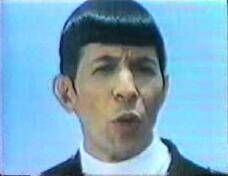
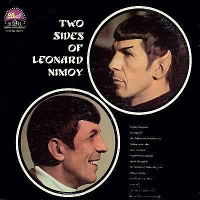
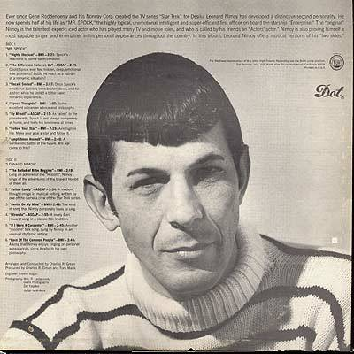

Sí, sí, sí. Como lo escucharon. Un homenaje a "El Hobbit" de Tolkien, cantada nada más y nada menos que por el personaje menos pensado del mundo, sí, el Sr. Spock!!!

Crean me que no me lo invente. Asi como ustedes, al principio, no podia creerlo, pero es verdad. Un triste -tristícimo- producto de la decada de los 60s.

\
*Imagen del video del Sr. Spock.*

"La Balada de Bilbo Baggins" fue compuesta por Charles R. Grean e interpretada por Leonard Nimoy. Cuenta la historia de Biblo, y su aventura como aparece en el libro "El Hobbit", de J. R. R. Tolkien.

Lo más increible es que ademas del disco, tambien editaron un sencillo de este tema, realmente le tenian fe al muchacho!

Luego de escucharla es fácil de entender por qué es comunmente citada como *la peor canción de todos los tiempos*.

\
*Tapa.*

\
*Contra tapa.*

Pero si esto no fuera poco, filmaron un video. No solo esta el Sr. Spock sino que ademas hay una banda de adolecentes carilindos vesrtidos de coloers y *con orejas de elfo* saltando por todas partes. Realmente algo digno de verse. Pueden bajarce el video desde [aquí](mainframe/movies/fun/bilboballad.wmv).

Luego de ver este verdadero monumento al mal gusto, debo reconocer que el Sr. Spock me llevo a donde ningún hombre ha hido antes, no deberia volver a ir.

Como comentario final, luego de ver detenidamente las escenas más oscuras de la cultura popular, cosas que cambian a un hombre, solo puedo decir que tengo miedo. ;D
