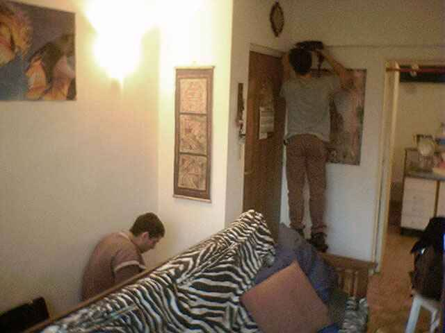
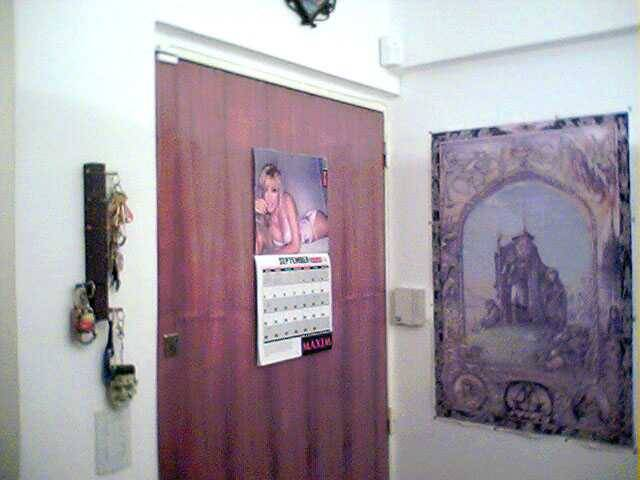

Esta semana mi mamá me regalo un sistema de alarma que recientemente quedo en desuso en un local. Hace bastante que yo deseaba una alarma para esos días que paso fuera. El sistema lo obtuvieron en una promoción y no costo nada, solo el abono.

Los técnicos llegaron a casa a eso de las 4 de la tarde y comenzaron a colocar el sistema. Por suerte no hubo necesidad de pasar cables por todos lados y a que todos los censores pudieron ser colocados en la misma zona de la casa, y cubren la puerta de entrada y movimientos desde la puerta hasta el patio exterior que es lo que yo más deseaba.

\
*Técnicos de ADT colocando mi nueva alarma.*

En tan solo 3 horas cablearon dos censores, un teclado de control, una alarma y la caja del equipo, y por mi parte pude llamar y configurar con la central las palabras clave de emergencia, así como configurar las clave de acceso y la clave de falsa desactivación.

\
*Ahora sí, malhechores, cuídense!*

Cuando estaba probando los códigos, sin querer ingrese el código de alarma silenciosa. Fue muy interesante que me tocaran el portero y al atender era la policía!\
Subieron y constataron que era una falsa alarma. Debo confesar que me puse algo nervioso, nunca antes había tenido un contacto de cerca con la policía - yo soy un chico "bien"-. Es interesante remarcar que llegaron a los pocos minutos de haber ingresado el código, lo cual es muy bueno, luego los agentes me tomaron los datos.... en una servilleta de papel, y...made in Argentina.
