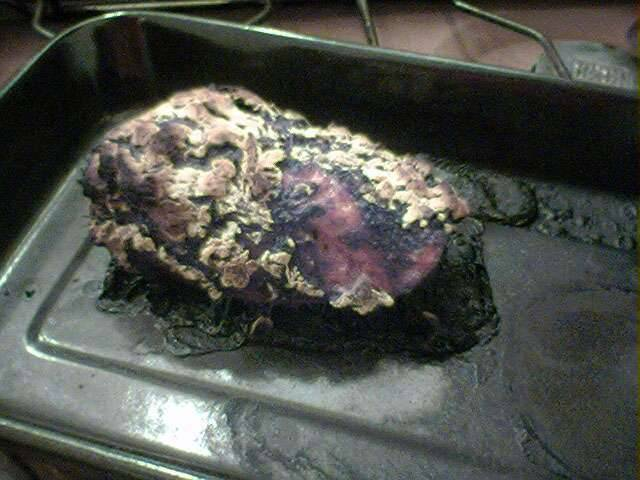
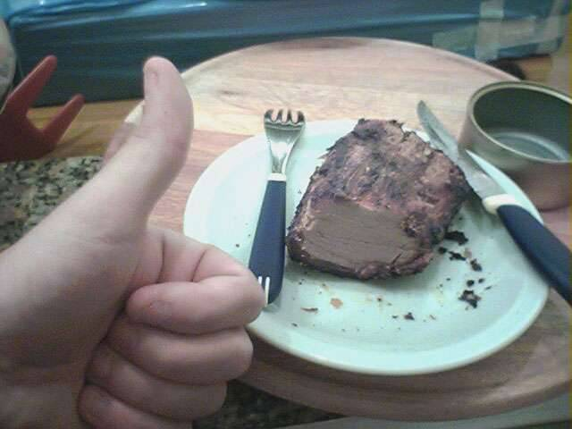
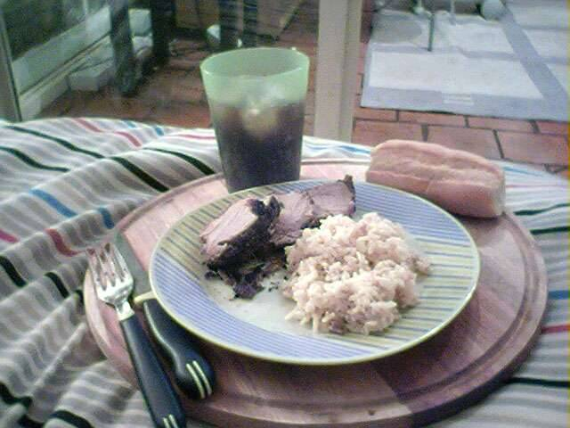

Quien me conoce sabe que la comida chatarra y las pre-pizzas conforman gran parte de mi pirámide alimenticia. Es por eso que, con la esperanza de abrazar una vide de sana alimentación, compre en el supermercado una pieza de carne. Como no tenia ni idea busque la que se viera más apetitosa (si eso puede aplicarse a la carne cruda en una bandeja), de mayor tamaño y -sobre todo- más barata que encontré.

Pasaron unos buenos días hasta que me anime a la empresa de cocinar la carne. Así que un buen día la descongele y la prepare. Primero la desgrasé y descubrí que me habían embaucado en el supermercado, pues por os casi 7 pesos que pagué por la carne recibí 1/3 de pura, sólida y resbalosa grasa. Así que una ves que tuve la carne separada, la remoje en mostaza, cebolla de verdeo picada y le di una pequeña capa de harina. Finalmente la metí en el horno,…..a la carne.

Media hora después abrí el horno y horrorizado descubrí que mi apetitosa carne a la mostaza había sido remplazada por un informe alien de otro mundo!!!!

\
*¡¡¿Dónde esta mi carne?!!*

Sin embargo..., luego de un detallado análisis (lo pinché con el tenedor a ver si se movía) llegue a la conclusión de que no se trataba de un alien, era de hecho, la carne!\
Ya estaba a punto de tirar mi primer fracaso culinario al tacho de basura cuando se me ocurrió verificar el interior de la carne por si se podía salvar algo. Y así fue que tome un cuchillo y corte un trozo. Para mi sorpresa la carne estaba muy tierna y sabrosa, lo cual es sorprendente teniendo en cuenta el aspecto exterior, rocoso y lleno de costras blancas y duras de harina cosida.

\
*Qué sorpresa, después de todo salio estupenda!*

Así que al final fue todo un éxito (casi). Tenía mi cena lista para comer a la noche. Acompañe la carne con una ración de arroz con atún, que por cierto fue uno de mis primeros experimentos culinarios. El único problema fue que no tuve en cuenta el "factor de contracción térmica", por el cual la carne se achica al cocinarla, y todo el experimento solo me alcanzo para 3 comidas.

\
*Mmmm... rico!*
