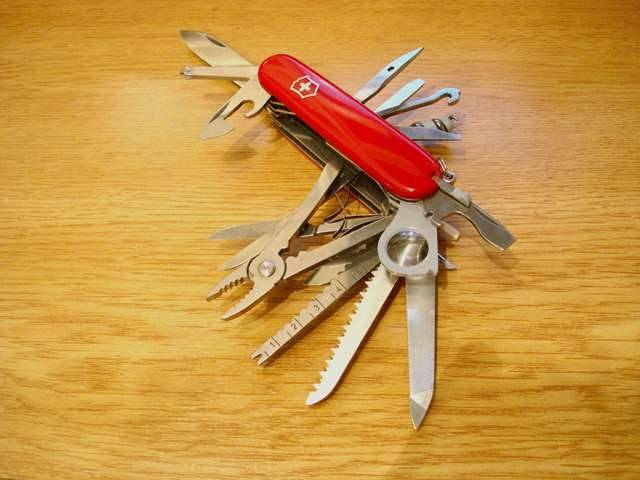

En un post anterior conte que estuve trabajando en un video de psicoterapias que tomo mucho tiempo y casi no sale. Por suerte, como ya conte anteriormente, finalmente salio a tiempo y cumpli. Aun sigo trabajando en el tema, ya que falta la version larga.

Cuando lo entregue quedaron todos los involucrados muy satisfechos, pues el video formaba gran parte de la exposición que debian realizar, sino es que toda. Me felicitaron en su momento, y yo quede my satisfecho por todo el asunto. No se si mensione que fue un trabajo ad honorem....

El viernes se me hacerca mi mamá -quien es un mienbro de este grupo- y en nombre de todo el resto me entrega una bolsa con un regalo para Tomás --con quién realice el video- y para mi.

\
Grande fue mi sorpresa cuando al habrir mi regalo encontre una fantástica cortapluma Victorinox modelo Champ, que es la que los astronautas llevan al espacio regularmente.\
El asunto es que hace unos mese me robaron una que yo tenia (una CyberToll34, el que la alla visto es la que tiene un juego de destornilladores especiales para PC) y quede muy triste. No solo por la pérdida - a quién le gusta que le roben- pero ademas por que yo tengo una naturaleza bastante inquieta y me encanta desarmar todo o que caiga en mis mano, tambien soy un fanatico del DIY (Do It Yourself, o en español, Hagalo Ustéd Mismo) y la verdad es que no herramienta como la cortaplumas. Me hasia falta. A tomas le regalaron una mochila tipo Serf que a el le encantan.

\
*Modelo Champ!!!!*

Tiene de todo. Destaco un par de herramientas que siempre utilizo que son la pinza, que es muy exacta y util, la tijera, y ahora -pues antes yo no tenia- el serrucho, la cierra de metales, la regla, el lente de aumento, el destornillador tipo Phillips (el de la cruz) grande, y una herramienta que no conocia que es para tallar madera y dar angulo, como una wida.

Sencillamente inncreible. Me puse entonces a pensar en hacerme un estuche para no rallarla, yu poder llevarla en el sinto. Ya tengo pensado anlo, ya má adelante lo mostrare..
