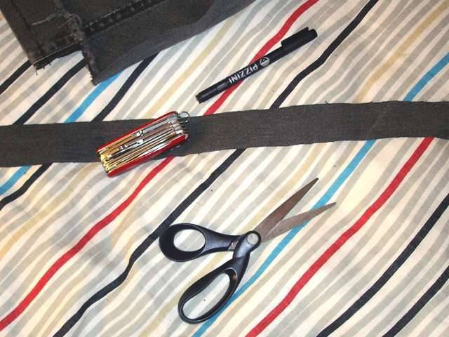
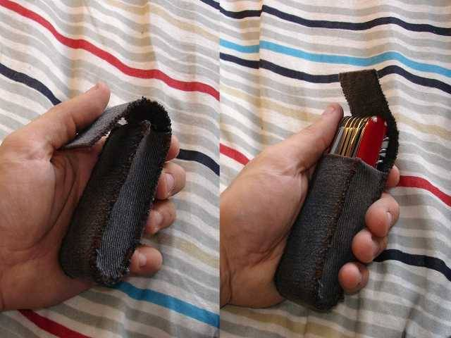
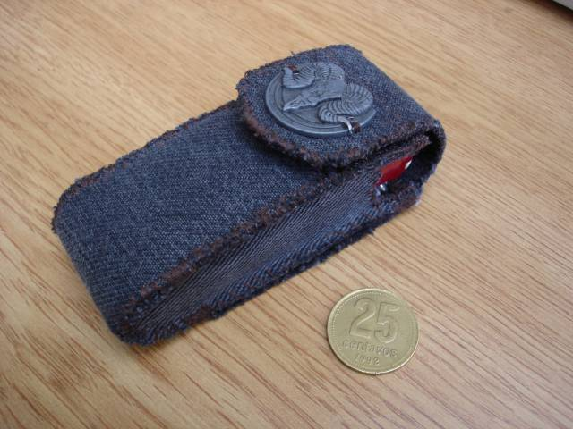

Como sabran hace poco recivi de regalo una cortaplumas victorinox. Anteriormente yo tenia una que me fue robada en un triste episodio, aunque nada más perdiera la cortaplumas. Desde entonces es que estaba buscando un remplazo y este regalo no pudeo venirme mejor.

Ahoro, yo antes tenia un estuche para llevarla, y como es una cortaplumas un poco boluminosa, este estuche se hacia muy conveniente. Es de lamentar el precio exsorvitado de los estuches de cuero para cortaplumas, asi que decidi fabricarme uno.

*Materiales:*\
-Una pieza de género resistente. Yo use Jean negro de un viejo pantalón.\
-Hilo, yo tenia marrón.\
-Una botella de Coca-Cola de 2,25 litros.

Ahora, corte una sola tira de tela del largo necesario como para darle una vuelta y cuarto a la cortaplumas y volver, de esta forma tendría dos capas de tela en lugar de solo una. Pero ademas resulto que no fue suficientemente fuerte y decidi darle un refuerzo plástico por dentro. Ahi es donde entra la botella de coca-cola. Debajo de la etiqueta de una botella hay una seccion de plástico lisa, de suficiente diámetro como para obtener una cinta de 4 centimetros de ancho y 24 de largo para reforzar por dentro todo el estuche.

En escencia cosi una media con la tela y antes de cerrarla del todo introduje el plastico en su interior. Luego cosi dos laterales a los ..... laterales, claro. :) Los reforce dandole dobles puntadas y reforando las esquinas con puntadas continuas por medio centímetro. Aun falta el velcro, no tenia ninguno disponible, ademas de la cinta para el cinturón. Pero ya se pueden ir dando una idea.

\
*Dos vistas, vacía y con la cortaplumas a medio camino del fondo.*

La verdad es que me quedo un poco ajustada, y olvide dejar un pequeño espacio a los lados para meter los dedo y retirar la cortapluma, por lo que -por ahora- debo sacudir un poco el estuche para sacarla. Un buen primer intento, dejenme decir. Ademas el estuche mantiene la forma gracias al plástico, y éste ultimo lo hace más recistente a los golpes. Traten de romper a patadas una botella de cocacola y van a ver que solo consiguen abollarla.

La proxima ves voy a ver si consigo un buen pedazo de cuero y me fabrico mi propio estuche victorinox. O en una de esas es más varato comprar el orogial, pero no lo creo.

\
Update! - 06/10/2005

Luego de un par de días me hice tiempo de comprar el material que me faltaba para terminar el estuche. Conseguí el velero en una mercería cerca de casa, y del mismo pantalón del que obtuve la tela saque un aplique de metal que queda perfecto en la tapa del estuche. Igualito al estuche que tenia de Victorinox.

Modifique algunas cosas, por ejemplo corte un semicírculo a los lados del estuche para poder meter los dedos y tomar la cortaplumas para sacarla, de otra forma se hacia muy complicado pues debía sacudir el estuche, cosa en extremo complicada si esta sujeto al cinturón del pantalón.

Finalmente también cosí una correa para el pantalón. Hoy realicé la primera prueba de residencia y resulto satisfactoria. La tela se ha empezado a estirar, ajustándose a la forma del cortaplumas, y gracias al refuerzo de plástico -el estuche- mantiene la forma en todo momento. El aplique de metal le da rigidez a la tapa y queda muy bien. Un éxito, realmente, mejor de lo que yo mismo hubiera esperado.
