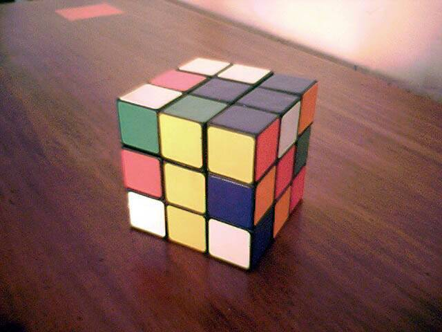

El viernes pasado, llegando yo temprano a mi acostumbrada clase de Comunicación de los viernes, mi distraidos pasos me llevaron a una tienda de novedades y decidi entrar a comprar un cubo rubik.

\
*Mi nuevo y no tan reluciente cubo rubik.*

Reciente mente me surgieron memorias de mi infancia y de que tenia un cubo -ahora perdido- el cual nunca pude resolver más que una cara a la vez. Nunca fui capas de pasar de allí, y decidi buscar información en internet, y valla que la encontré. Completos manuales de soluciones. Asi que aquí las comparto con ustedes:

- <http://wrongway.org/cube/solve.html> - Es un link a un applete que le damos la configuración de nuestro cubo y genera una lista de movimientos para resolverlo. Muy bueno.
- <http://jjorg.chem.unc.edu/personal/monroe/cube/rubik.html> - Otra guia paso a paso.
- <http://www.olympus.net/personal/prmhem/step_one.htm> - Buena guia por el método de la cruz.

Espero les haya gustado.
