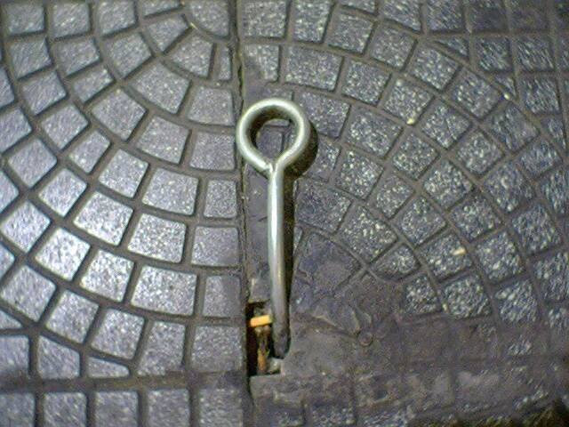
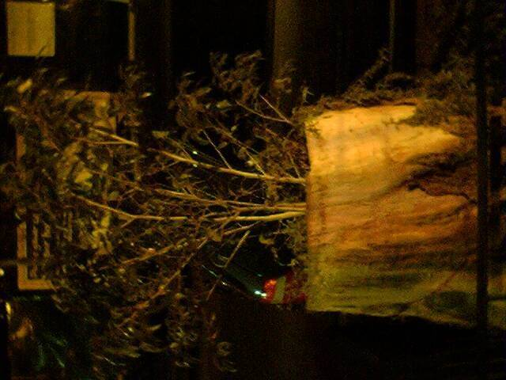
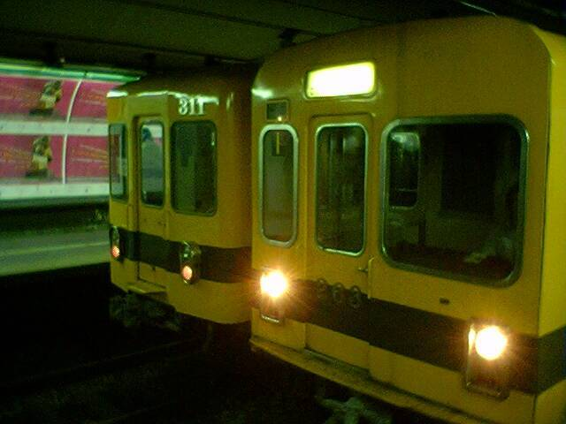

Una de las cosas que más me gusta de mi palm (Soñ Clie PEG-TJ37) es el poder sacar fotos en el momento menos pensado, de a poco voy aprendiendo a capturar esos momentos, imágenes tan efímeras que de otra manera se perderian tras el inmutable fluir del tiempo.

De cuando en cuando voy a ir subiendo estas imágenes, en su mayoria son de lugares y rincones con los que me cruzo de manera casual, no tienen mucha resolución, la suficiente como para capturar el momento y de esa forma compartirlo con quien asi lo desee.

\
*Un ancla para cable de poste, visto desde arriba. Esquina de Av. Santa Fé y Vidt.*

\
*Una foto de esperanza y resurrección. Un brote de eucalipto naciendo de un muñon seco.*

\
*No se qué tan rara sea esta foto, pero son dos subtes que pararon exactamente en el mismo punto.*

Nada más por ahora.
