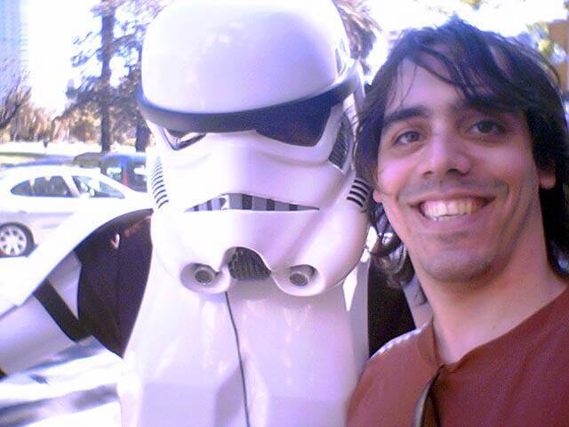

El mismo día que estabamos preparando el torneo para el dái siguiente, tomas tubo que ir a practicar por ultima vez con el equipo de formas. Se juntaron en la plaza Salguero, en Salguero -obvio- y Las Heras. me invitaron a ir a verlos pero lamentablemente no lo spude encontrar -mas tarde descubri que estaban en el unico lugar en el que no ma habia fijado, clásico-.

Mientras daba vueltas por la plaza vuscando un grupo de hombres vestidos de blanco, divise en entre las ramas de un arbol un hombre vestido de blanco a la distancia. Resulto que en frente a la plaza, parado en una esquina habia un Storm Trooper. Sí, sí, un verdadero Storm Trooper, o Soldado Imperial de la archireconocida película Star Wars. Lo curioso es que no estaba promocionando náda. Por lo que le pude oir comentar por el celular a la novia, éste muchacho habia ido a buscar el disfras a la casa de un amigo y estaba en la esquina esperando a que lo vinieran a recojer.... No lo dude ni un minuto y le pedi sacarnos una foto.

\
*Increible pero real, un Storm Trooper para mí solo.*
