Este fin de semana -el domíngose para ser exactos- se llevo a cabo el torneo AR OPEN '05 de Taekwon-do organizado por mi escuela (ETRA). Fue algo bastante interesante pues se trataba de un nacionál, ni mas ni menos, y vino gente desde el interiór, tan lejos como el Chaco, e incluso desde el exterior, desde Uruguay. En total vinieron más de 200 personas a competir, más espectadores.

Como Director y sub-Directore de Medios y Diseño de la escuela, a Tomás y a mí nos correspondió el fabricar las acreditaciónes oficiales del evento, que acreditan al portador como Couch, Auxiliar, Vip, etc., ademas de diseñar las entradas de competirdor, las de espectador, las remeras oficiales, los carteles de los sponsors (Gran Mark, la revista Yudo Karate, la revísta Espíritu Marciál, entre otros), los identificadores de bolsillo para los jueces de mesa, y finalmente el colocarle las cintas a las medallas (405 en total).

El tema de las medallas fue el que más tiempo consumió, por la enorme cantidad. La fabrica donde las mandaron a hacer, les podia colocar una cinta celeste y blanca (la bandera Argentina) por el mismo precio que nos salio comprar tres cintas de colores más interesantes. Y es que la cinta e argentina es de muy mala cantidad, muy delgada y el nudo en el extremo se suele deshilachar de una forma poco estética. Por eso decidimos que le pondríamos nosotros mismos la cinta... un grave error de calculo. Tarde nos dimos cuenta de la apabullante cantidad de trabajo que implicaban 405 medallas. Por suerte contamos con la ayuda de nuestros companeros que apesar de que al día siguiente competían, se quedaron a ayudar hasta entrada la noche con el trabajo.

[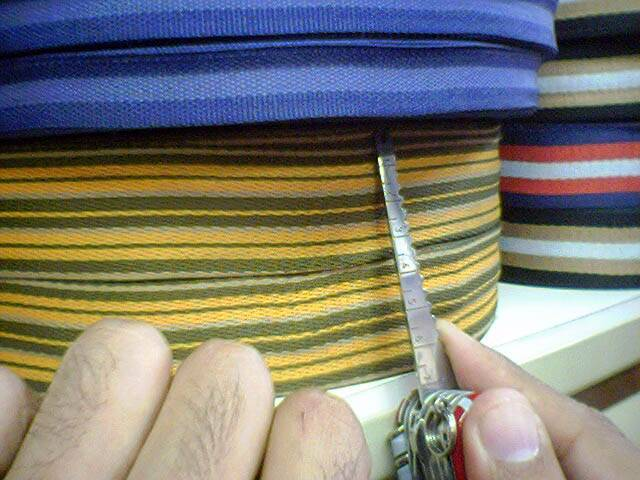](/assets/blog/legacy/aropen05_1.jpg)\
*Tomás midiendo una cinta, que finalmente resulto demaciado ancha.*

[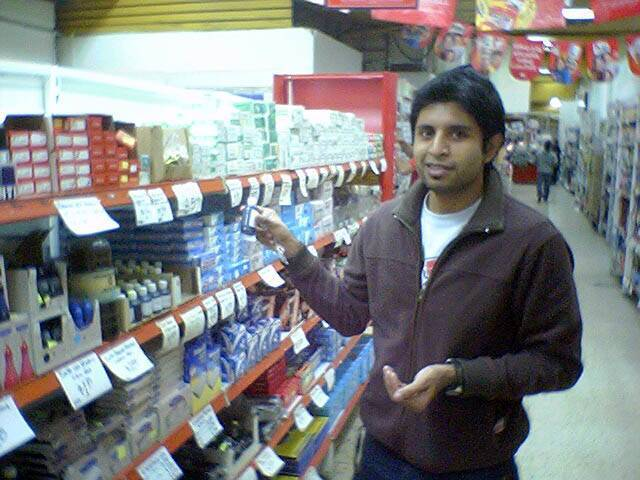](/assets/blog/legacy/aropen05_2.jpg)\
*Comprando en una libreria mayorista, los idenificadores.*

[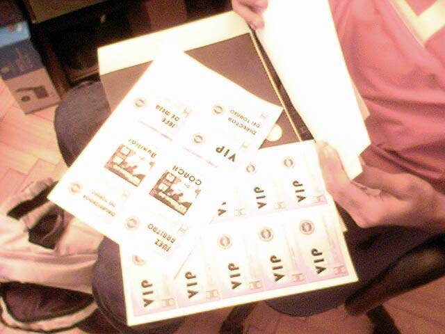](/assets/blog/legacy/aropen05_3.jpg)\
*Plancha de impresión de las credenciales, recien salidas de la impresora.*

[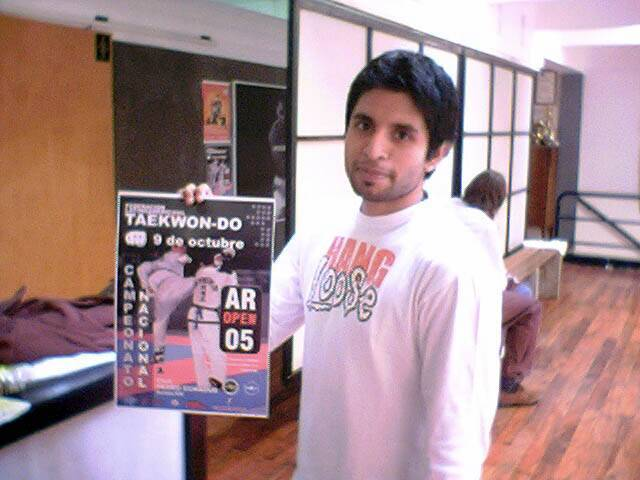](/assets/blog/legacy/aropen05_4.jpg)\
*A la mañana siguiente, entre otros preparativos, entregamos los posters.*

[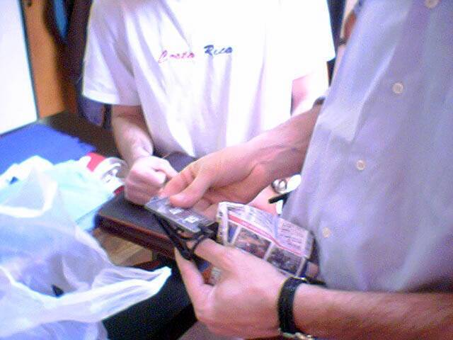](/assets/blog/legacy/aropen05_5.jpg)\
*Recien el sábado a la tarde recivimos las medallas y pudimos darle una primera mirada.*

[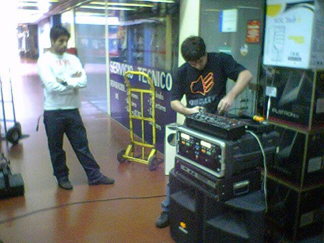](/assets/blog/legacy/aropen05_6.jpg)\
*Luego, fuimos a retirar los equipos de audio (parlantes, micrófono VHF, mixer, y bandejas).*

[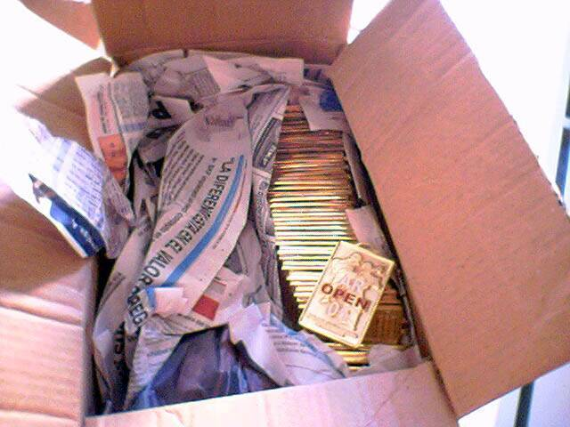](/assets/blog/legacy/aropen05_7.jpg)\
*Finalmente llegamos a lo de Tomás y pudimos ver de cerca las medallas.*

[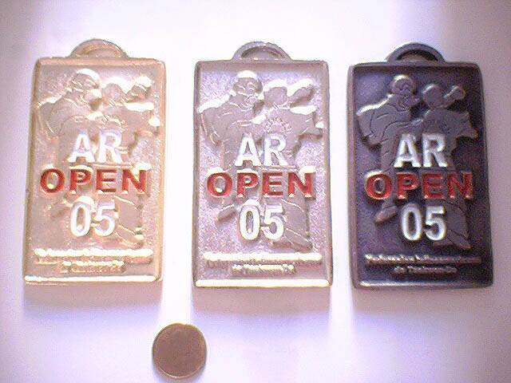](/assets/blog/legacy/aropen05_8.jpg)\
*Las tres medallas, 1er, 2do y 3er lugar junto a una moneda de\
10 centavos. El diseño tambien es própio.*

[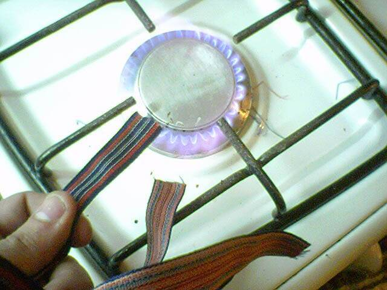](/assets/blog/legacy/aropen05_9.jpg)\
*Usamos una cacerola que casualmente tenia un perímetro como largas\
necesitabamos las cintas, esto facilito el cortarlas en cantidad y rapidamente.\
Luego para evitar el deshilache les derreti los extremos personalmente.*

[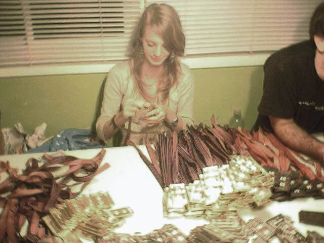](/assets/blog/legacy/aropen05_10.jpg)\
*Desiree, junto con Germán y Vicky, se ocuparon de pasar y anudar las 405 cintas\
a sus respectivas medallas, segun el color. Azúl para las doradas, verde para las de\
plata y naranja para las de bronce. Sin su ayuda no hubiera sido posible. Gracias.*

[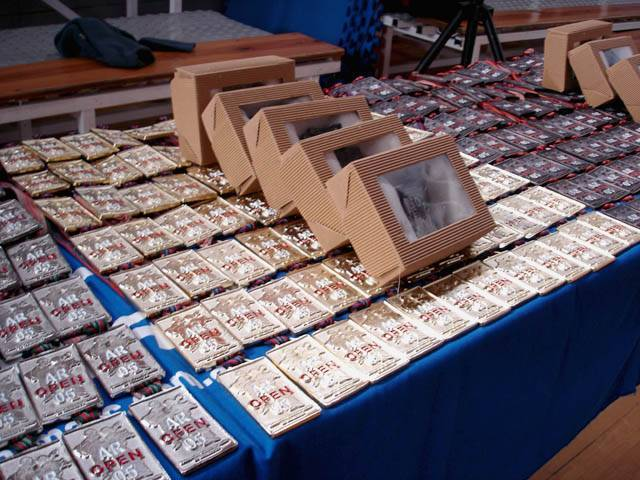](/assets/blog/legacy/aropen05_11.jpg)\
*Esta es la mesa de premiación y se pueden ver todas las medallas.*

[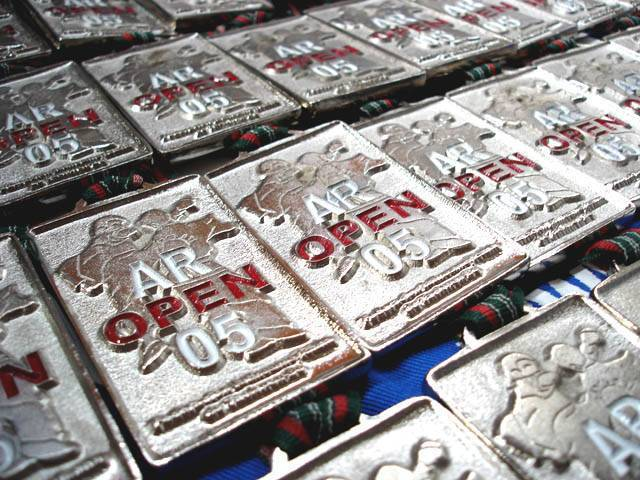](/assets/blog/legacy/aropen05_12.jpg)\
*Aquí se pueden ver en detalle las medallas de plata. Que buen fotografo que soy.*

Espero que este bereve, brevísimo testimonio de nuestro trabajo les halla gustado y quiero finalizar agradeciendo a toda la gente que tambien colaboro, qué digo colaborár, activamente organizó un montón de cosas incluso más complicadas que estas como organizar a los jueces y árbitros, conseguir traer y armar los pisos de los rings y no se cuantas cosas más que seguramente jamas sabre, sin la cual este evento nunca hubiera sido posible. Esta solo es mi historia, una de muchas. Gracias.
