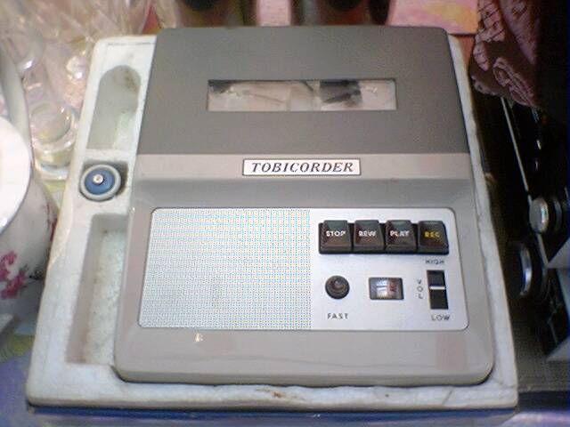
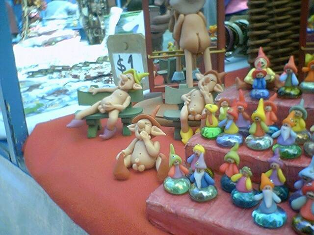
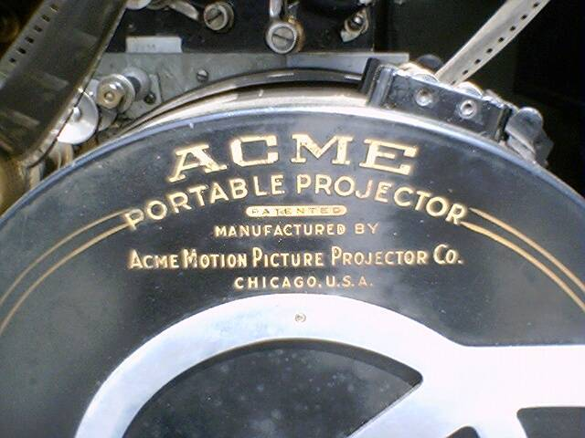
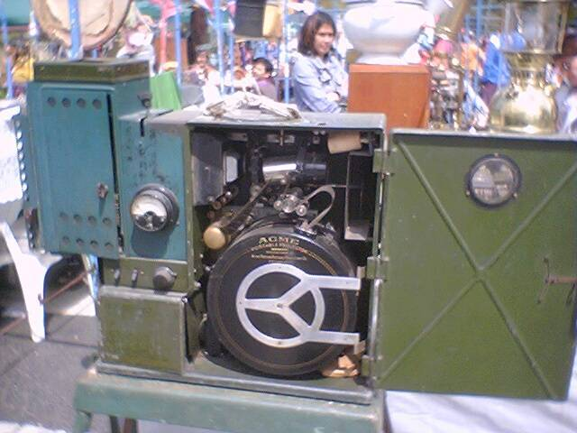
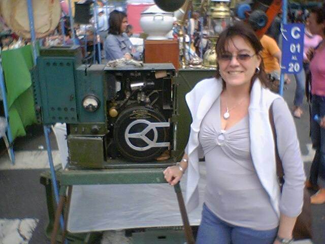
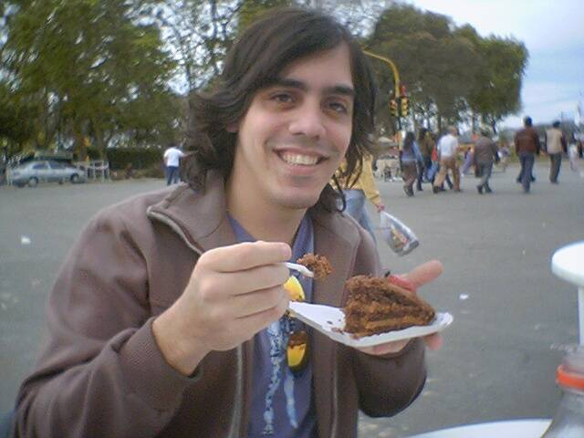
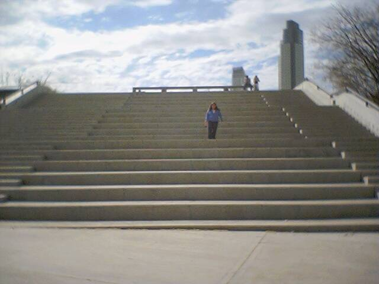
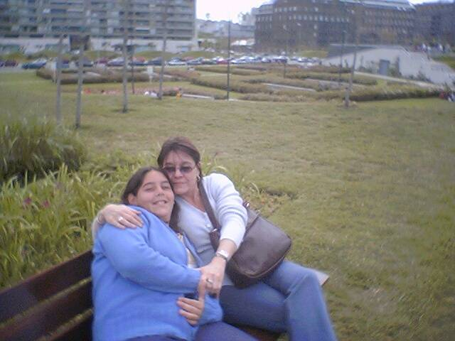
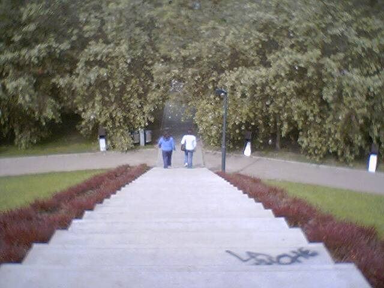
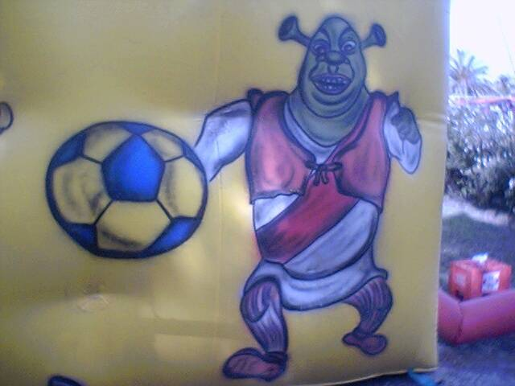

El día de la madre lo pase con mi mamá -por supuesto- y mi hermanita Marina. Fuimos a la feria de costanera sur, que esta lleno de antiguedades.\
La verdad es que la ultima vez que yo habia ido a este lugar fue hace bastantes años, a pasear en bicicleta (me la robaron -dicho sea de paso- y no volví más). Ahora hay todo una barrio nuebo, construido donde antes habia fábricas y terrenos baldios, De hecho, es un barrio de mucho nivel (económico, si me entienden), me llamo la atención por que a diferencia del resto de la ciudad, este barrio se encunetra muy bien urbanizado, con caches anchas y ordenadas, incluso hay kuioscos y bares, como tambien joyerias y tiendas de puros. No por nada el metro cuadrado cuesta una fortuna.

Lo primero que hicimos fue recorrer algunos puestos. Siempre ancioso por realizar algun descubrimiento al mejor estilo "Feria de antiguedades" (el programa de cable que sale en People & Arts). Claro, que estamos en Argentina y no hay muchas antiguedades que digamos, no al menos en pocesión de los puesteros que para no morirse de hammbre benden hasta las canillas del patio.\
Sin embargo me encanta descubrir ejemplos de tecnologia *antigua*, y me refiero a jugetes, aparatos y otras parafernalias que yo no conozco pero que para mi mamá fueron de uso corriente, o incluso anteriores a ella.\
Un ejemplo es esta grabadora en perfeco estado. Aparentemente portatil (para la época quiza) y que si se fijan no usa cassettes, usa carretes de cinta magnética. Increible (que usaran estas cosas).

\
*Pasa cintas. No usa cassettes.*

Claro, con el tiempo la ferie que otora fuera de antiguedades se popularizón un poco y podemos encontrarnos puestos de inmundos saumerios (me caen mal los saumerios, que quieren que les diga?), y peor aun, para mí uno de los mejores ejemplos del hippi vende porquerias: **el duende de poxilina**. Si creian que un duende abrazando un saumerio es una porqueria, imaginense uno rascandose *el higo*, asquerozo. Quisiera ver que alguien lo compre para decorar la casa, se lo deben vender entre ellos, hippies mugrosos (ojo que aquí por hippis no me refiero al movimiento, me refiero a estos vagos de porqueria que hacen estas *artesanias* en lugar de trabajar o militar por alguna causa noble, como todo buen hippi)..

\
*Pero qué pedazo..... de porqueria.*

Entonces vi algo muy interesante. Resulto un proyector portatil de cine, marca ACME por supuesto. Me pregunto de qué cine se lo abran choreado?.... ejem!. En fin, pudene ver que fue fabricado en Chicago, USA, y ademas le saque una foto junto a mi mamá para que puedan ver la escala real. me parece que ella creia que le queria sacar una foto a ella... dejemoslo así.

\
*Proyector portatil marca ACME.*

\
*Proyector completo*

\
*Proyector a escala. La bonita señora de la derecha es mi mamá.*

En tre una cosa y otra estubimos caminando más de una hora y decidimos que hera tiempo de comer. Pasamos por una parrilla que estaba en uno de los puestos y nos comimos unos buenos sanguches de hamburgesa. De postre un pedazo de torta de chocolate, bañada en chocolate y rellena de dulce de leche (hay! mi diabetes...).

\
*y como postre una bomba de chocolate.*

Luego nos fuimos a caminar por la plaza elevada, idea de Marina. La escalera era bastante grande, la verdad, pueden apreciarlo con esta foto donde Marina posa a desgana (ya empezo con que no le saquen fotos.... estas mujeres).

\
*Flor de escaleras.*

Descansamos en un rincon hermoso, rodeado de pasto y canteros llenos de flores. La vrdad que es la mejor plaza que he visto. Tiene rincones llenos de sol y flores, lugares para tomar sol, soba lugar para que esten jugando los chicos al futbol y ni te molesten... muy bien pensada.

\
*Un lindo rincón, y dos lindas chicas.*

Luego de descansar un rato y tomar sol, bajamos por una de las escaleras laterales, la cual se perdia entre un monte muy bien plantado, da gusto ver todo cuidado y bien construido.

\
*Entrando al bosque.*

Caminamos hasta lo que creimos era la parada de taxis, y atrabezamos ota plaza, la cual tenia una calesita, un par de juegos, una heladería e incluso un tobogán gigante inflable... el cual estaba decorado por dos personajes del cine y la TV, Bart Simpsons y Shrek, pero claro, indefectiblemente estaban adaptados a la cultura popular, vean:

\
*Shrek aparentemente es fan de River.\
Cosa curiosa, en la pelicula no se da a entender.*

\
*Por otra parte Bart es secretamente fan de Boca.\
Increible que en trece años de verlo nunca me diera cuenta.*

Mientras esperabamos nos comomos un helado, para bajar la torat claro, y esperamos... y esperamos. Luego, esperamos otro poco. No, ningun taxi. Asi que caminamos hasta la otra punta del la feria y nos detubimos un rato pues Mamá queria ver un puesto antes de irnos. Mientra la esperabamos nos quedamos a ver *show* de un pobre nabo que pretendia ser gracioso, pero la verdad era que daba lástima. Incluso se subió a un semáforo y se puso a gritar... todo un show ciertamente.

Al final conseguimos taxi y llegamos a casa. Mamá me regalo un muñeco de BettleJuice (de la película) pues yo tengo dos que ella me trajo en un viaje y con este ya son tres, ademas estaba muy bueno, se movia y todo, y solo costo 10 pesos. Tambien por la misma plata consegui un juego completo (casi, falta la "J") de sellos de letras, que aparentemente se utilizaban en alguna imrenta, no pude obtener más información del vendedor. Mamá se compro un dado de metal con todo y base que yo me encargue de limpiar y pulir en mi casa (que buen ojo tiene). Marina se compro un montón de muñequitos de Los Simpsons, de los que venian de regalo en los chocolates Jack durante el año pasado y este, Tiene un montón y estam muy bien hechos, algunos incluso se mueven, una buena colección.

La pasamos muy bien, fue muy dibertido y espero volver a salir así. Fue mucho más barato y dibertido que ir al cine, ademas de que tomamos aires y sol. Algo para tener en cuenta.
