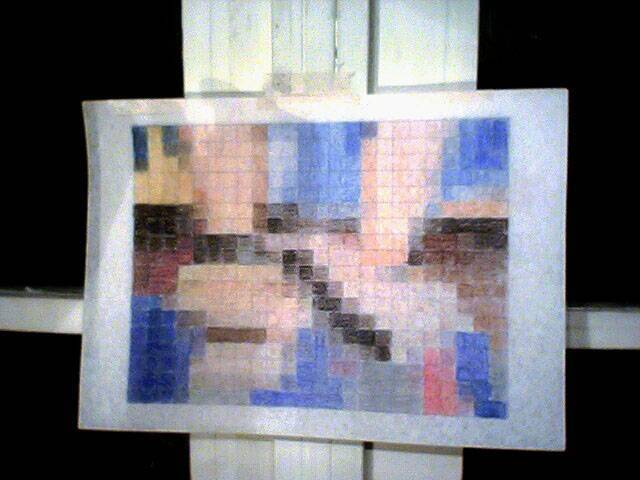
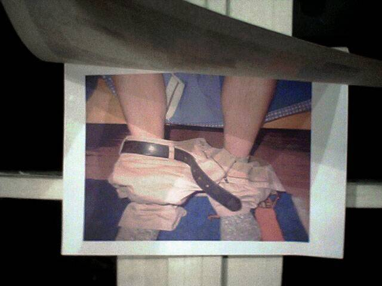

Hoy entregue un trabajo práctico para la materia de diseño gráfico I. Debiamos pixcelar a mano una foto cualquiera . La idea es que más adelante la pasemos a PC, pintando cuadro por cuadro con colores plenos.

Para pixelar correctamente la foto cuadricule una hoja de calcar sobre la foto. Luego fui pintando los cuadros (pixels) de uno en uno. El truco conciste en que si debajo de un pixel hay más de un tono de color debemos promediar los colores a ojo y pintar el pixcel con ese color pleno que calculamos. O sea que no se puede pintar medio pixel de un tono y medio de otro.

Así y todo logre bastante bien la imagen. Tenia ganas de eleguir una imagen donde tubiera bien claro los contrastes de color y ademas que fuera interesante, ya que me pase casi dos horas pintando cuadrados.

Pueden ver la imagen pixelada más abajo, y a continuación el originál:

\
*Pixelado a mano.*

\
*Original. No, no soy yo.... :)*

El profesor me pregunto si se trataba de mí (no, no soy yo) y hasta me pidio ver mis zapatos a ver si eran los mismos. Pero me acepto el trabajo como bueno, ya que, al fin y al cabo la imagen se reconocía perfectamente (bueno, casi).
