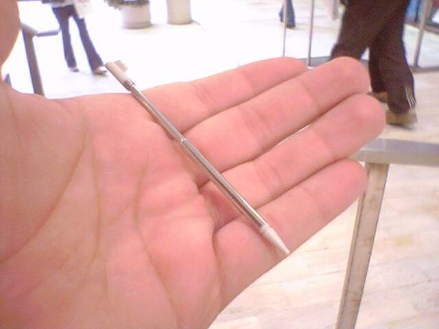

Mas de un año ha pasado desde que perdi el stylus de mi palm (el lapicito). Se cayo en algun momento que no pude determinar. Triste consuelo parece ser que no soy el unico.\
Por casi 6 meses he intentado comprar uno nuevo pero Soñ dejo de fabricar palms y el lapiz que necesito es un modelo especial, que es retractil, por lo que los stylus genericos de la lonea Clie no mesirven... Incluso en un reciente viaje a USA intente encontrar un repuesto sin ningun exito.

\
Hoy, el profesor de video (quien tiene mi mismo modelo) me comento que el tambien pierde su stylus cada tanto, pero que los compra en la Galeria Jardin (Florida 547, Cap. Fed.).

\
*Por fin puedo volver a escribir sin gastarme el dedo!*

Increible que despues de recorrer mas de 3000 kilometros buscando un remplazo, lo consiguiera a solo 15 cuadras de la facultad. Increible. Este repuesto no es oficial de Soñ -a quien le importa- y entra mas justado que el original, lo cual es mejor; como yapa tiene una mini-birome escondida en la tapa, toda una mejoria.\
Tenia pensado fabricarme uno y en mi diseño utilizaria una pequeña antena. Ahora veo que el sylus que compre se basa en el mismo principio... Me parece que voy a fabricarlo, solo para ver... :)

\[palm:Blogged - Subte linea D\]
