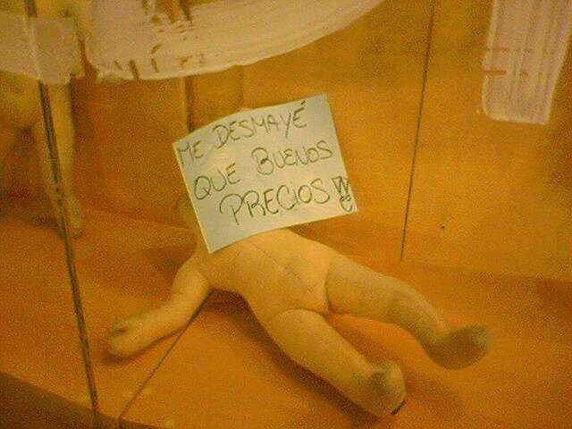

El otro dia, luego de bajarme del subte (o seria subirme del subte) pase por esta vidriera de muy interesante diseño.

Creo que la foto se explica sola. Pero no es solo la fota, es que se trata de un maniqui desnudo de un chico, y hebia muchos mas, como en una playa nudista para enanos...

\
*Totalmente freak!*
