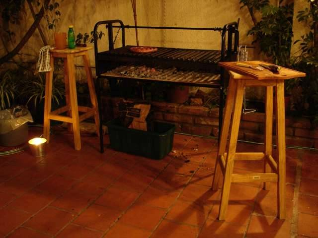
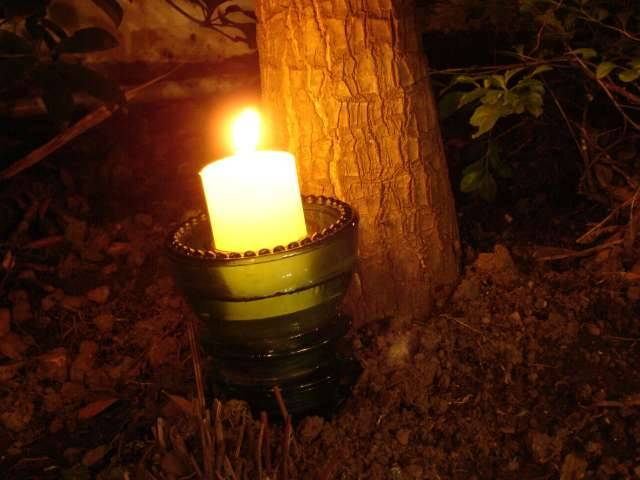
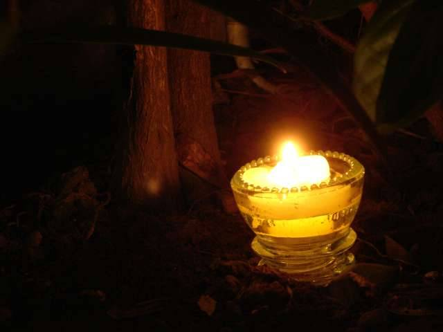
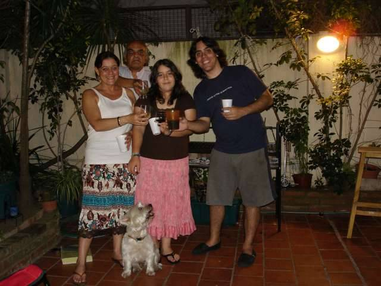

"Feliza me muero! - Dijo el abuelo mientras se atragantaba con una uva y el reloj del estudio daba la doceaba campanada que así marcaba el comienzo de un nuevo año".

Cada 1 de enero, un año que se va y otro que llega. Nuevas esperanzas de un mañana mejor. Este año lo pase con mi familia (mamá, marina y el tio tino). Por primera ves en casi dos años dede que me mude a mi casa, esta todo limpio, ordenado, y el jardin esta arreglado.

Como me regalaron una parrilla para mi cumpleaños, no pudimos pensar en una mejor oportunidad que esta para estrenarla. Prepare el carbón, lo encendi con ayuda de unas ramitas que mamá junto al ordenar el jardin y todo andubo de mil maravillas.

\
*Mi parrilla nueva. A la izquierda y abajo se ve el valde con vela que me regalaron en mi cumpleaños.*

Mamá con unos viejos aisladores de cables de alta tención (que recojiera yo en el campo, en unos de esos veranos interminables que pase con mi amigo Tomás) armo unos hermosos posavelas que repartidos por todo el jardín creavan un clima mágico.

\
*Un posavela hecho de un antiguo aislador ingles de cables de alta tención.*

\
*Mi foto preferida.*

Comimos como cerdos, realmente. Comenzamos con unas salchichas parrilleras, luego con un matambrito de cerdo que -modestia aparte- me quedo excelente, finalmente concluimos con un buen pedazo de tira de asado. En la mesa teniamos ensaladas con tomates cherry (Ah, son como bombones!), y papines (otros bombones!). Y como broche de oro, pan dulce, confites y kilos de helados.... haaaagggjjjgaaa....

\
*De izquierda a derecha: Lucía (aka Mamá), el perro (aka, Black), el tío (aka Tino), mi hermana (aka Marina, aka "Soy cool"), y el parrillero (aka Lukas238).*

Nada más por ahora. Feliz año nuevo a todos!!!!!
