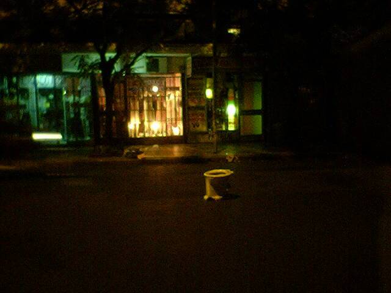

*Dicen que las calles estan hechas mi\*rda pero esto es ridículo.*

Anoche, salía de lo de mi amigo Tomas, luego de ver una película, y mientras me dirigía a la parada del colectivo, adivinen qué hay en medio de la calle (y me refiero al mismísimo centro de la calle)... un inhodoro blanco.

\
*La esquina de Güemes y Billinghurst ahora cuenta con inhodoro propio.*

Lo curioso es que por esa esquina pasan como 5 lineas de colectivos, y si bien a las 4 de la mañana la calle no esta particularmente transitada, no puedo dejar de preguntarme: ¿desde cuando esta el inhodoro depositado en ese lugar?, ¿cuánto durará antes de que se lo lleve puesto un colectivo, un auto o un distraido motociclista?, ¿quién lo habra puesto?, y -quizas la más importante pregunta de todas el perpetrador, de dónde rayos saco un inhodoro a las 4 de la mañana?!!!!
