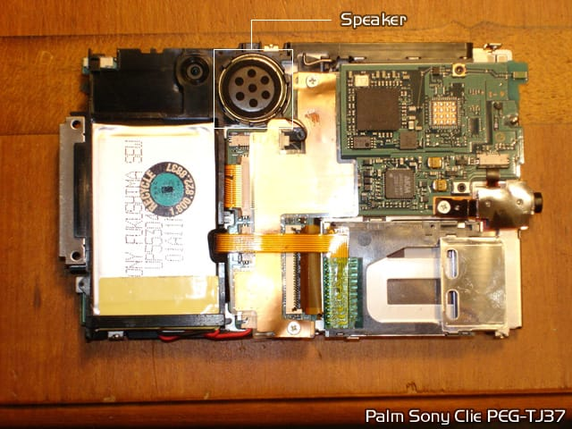
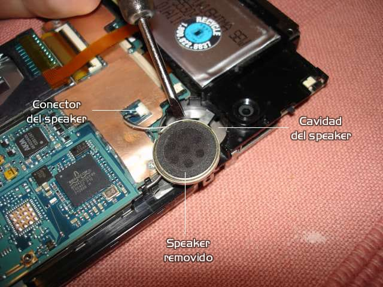
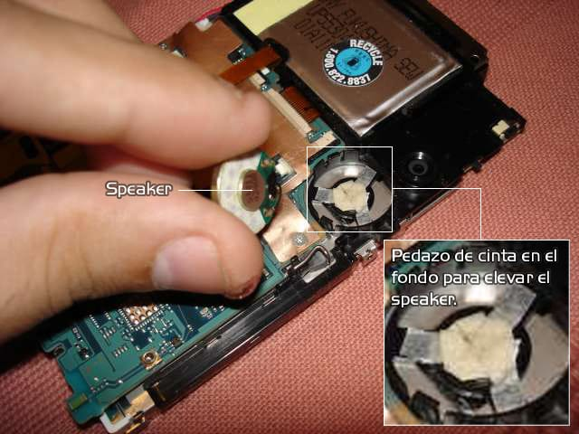

Para los que ya han visitado este blog anteriormente sabran que tengo una palm modelo Clie TJ-37, la cual es uno de mis poseciones más queridas.\
A mi me gusta sacarle *todo el jugo posible* a todo lo que tengo o hago, y quiza algun otro dueño de este modela halla notado como yo que el volumen del speaker -lamentablemente- es moderado cuando mucho.\
Jugando con la palm, un día me di cuenta que si apretaba la carcaza desde atras, el volumen subia notablemente.\
No necesite mucho para darme cuenta que al apretar la carcasa, esta hacia contacto con el speaker y se producia un efecto de caja de resonancia.\
Me decidi entonces a modificar el hardware para solucionar este problema de una ves por todas.

*Vista interna trasera de la TJ37. En el recuadro se señala el speaker.*

En esta foto pueden ver como se ven las entrañas de mi palm. No tiene mucha ciencia. El parlante sencillamente no llega a tocar la carcaza de la pam, asi que deberemos levantarlo uno o dos milímetros. Asi que lo primero sera desmontarlo de su cavidad.\

*Detalle del speaker siendo desmontado de su cavidad.*

El speaker esta sujeto con tres pequeñas pestañas, y basta con un destornillador pequeño para soltarlo. Hay que tener cuidado al removerlo pues esta sujeto al mother con su conector.

*Detalle de la pieza de cinta en el fondo de la cavidad del speaker.*

Una ves que retiramos el parlante, rellenamos el fondo de la cavidad con una pequeña pieza de cinta doblada sobre si misma, de no más de 1 milímetro, o incluso menos. La idea es levante el speaker y empujarlo contra la carcaza *lo juto* para que haga suficiente contacto como para transmitir las vivraciones sonoras, pero no tanta como para evitar que la carcaza cierre correctamente. Es cosa de prueba y error.

La mejora en el volumen es notorio. Se escucha facilmente al doble de volumen. Asi que ya ven. Un poco de maña y listo.

PD: Si se preguntan cómo logre soltar los dos tornillitos que tienen forma triangular para poder habrir la carcasa, les cuento que a falta de destornillador especial, me fabrique uno con una lija de metal y un viejo destornillador. Pero desde la experiencia puedo decirles que es más fácil buscar el destornillador que fabricarlo.
