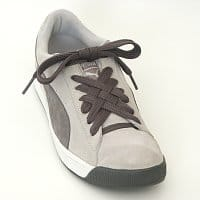

En un principio no parese la gran cosa, ¿pero alguna ves se preguntaron si habia una mejor manera de atarse los zapatos, o -como yo- simplemente repetian la tecnica que nos enseñaron de pequeños?

La web [Ian's Shoelace Site](http://www.fieggen.com/shoelace/index.htm) (*Sitio de atado de cordones de Ian*) nos trae una imprecionante base de datos con fotografías y gráficos paso a paso, de cómo atarnos los cordones.

Lo interesante es que hay diferentes tecnicas, dependiendo del resultado que queramos, estético, único, práctico, fácil de ajustar, dificil de aflojar.... e incluso estan ranqueados.

|  |  |
|----|----|
|  | Personalmente les recomiendo el [Lattice Lacing](http://www.fieggen.com/shoelace/latticelacing.htm) (*cordón enrejado*) para zapatillas de cordones anchos. Queda estupendo y la verdad es que me sorprendio descubrir que me ajusta el zapato más confortablemente que antes. |

No puede ser más barato o sencillo. No hay que comprar, cortar, pintar, cambiar, o romper nada. Y el resultado es muy original.
