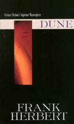

***Las Crónicas de Duna, Libro 1: Duna***

Por Frank Herbert

\
**Sinopsis:**

Arrakis: un planeta desértico donde el agua es el bien más preciado donde llorar a los muertos es el símbolo de máxima prodigalidad. Paul Atreides: un adolescente marcado por un destino singular, dotado de extraños poderes, abocado a convertirse en dictador, mesías y mártir. Los Harkonnen: personificación de las intrigas que rodean el Imperio Galáctico, buscan obtener el control sobre Arrakis para disponer de la melange, preciosa especia y uno de los bienes más codiciados del universo. Los Fremen: seres libre que han convertido el inhóspito paraje de Dune en su hogar, y que se sienten orgullosos de su pasado y temerosos de su futuro. Dune: una obra maestra unánimemente reconocida como la mejor saga de ciencia ficción de todos los tiempos.

Dune es considerada una de las obras más importantes de la literatura fantástica, de la ciencia ficción y en general. Fue escrita por **Frank Herbert** , un autor reconocido por sus novelas de ciencia ficción dura, y fue publicada en 1965. Ganó el **Premio Hugo**, y el **Premio Nebula** al mejor libro de ciencia ficción, y se le considera la más grande de las novelas de ciencia ficción de todos los tiempos.

Se trata de tres trilogías, de las cuales solo se llego a publicar cinco secuelas, pues el autor murió en 1986\
planeando el clímax.

- \
- Dune\
- Dune Messiah\
- Children of Dune\
- God Emperor of Dune\
- Heretics of Dune\
- Chapterhouse: Dune\

\
El libro Dune ha inspirado películas de renombre como **[Dune](http://www.imdb.com/title/tt0087182/)** del director **David Lynch** (como dato curioso el cantante **Sting** actuo en esa película en el papel de *Feyd-Rautha*), series de televisión que abarcan las tres primeras novelas de la saga **Dune** y **Children of Dune**, nuevas trilogías escritas por su hijo **Brian Herbert**, que publicará por demanda popular, el final en dos partes de esta excitante y dramática historia, la saga de Dune.

\
***Temas recurrentes:***\
([via Wikipedia](http://es.wikipedia.org/wiki/Dune))

Las consecuencias de poner las riendas del poder en manos de superhéroes, en lugar de dejarlas a una humanidad consciente y responsable conforman un tema corolario en la saga de Dune. En una famosa entrevista hecha por la Revista Omni en Julio de 1980, Frank Herbert dijo:

*"Se crean enormes problemas cuando los errores humanos se cometen en la escala de un superhéroe... Los héroes son un dolor, los superhéroes son una catástrofe. Los errores de los superhéroes nos llevan a la mayoría al desastre."*

También dijo:

*"Yo tenía esta teoría de que los superhéroes son desastrosos para los humanos, de que aunque crearas a un héroe infalible, las cosas que este héroe pondría en marcha podrían caer en manos de mortales errantes. ¿Qué mejor forma de destruir una civilización, sociedad o raza, que poner en manos de un superhéroe las salvajes convulsiones que siguen a su juicio crítico y a su poder de decisión?"*

Deliberadamente ignoró la súper-tecnología y los avances técnicos, prestando una gran atención a ideas sobre ecología, religión, cultura y humanidad. Esto hizo que en su tiempo se considerase esta saga como un cambio provocativo y atractivo con respecto a la ciencia ficción que se había escrito anteriormente.

La primera novela es la más "redonda" de todas, las premisas iniciales no se fuerzan en ningún momento, sino que se van extendiendo delicadamente para que el lector se vaya habituando a él. Los temas filosóficos y religiosos de Dune se desarrollan en una historia que muchos han visto paralela a la vida de Jesucristo o Lawrence de Arabia, filosofando sobre el mesianismo en primera persona.

En esta historia, Frank Herbert trata acerca de grandes temas de la política incluyendo la susceptibilidad humana a la manipulación en masa a través de la propaganda política, dogmas religiosos falsos (p.ej: La Missionaria Protectiva), la tentación sexual aplicada a las altas esferas de gobierno y la importancia del conocimiento de uno mismo y el autocontrol para poder resistir estas formas de manipulación, así como el estudio del poder y el control.

Desde una perspectiva histórica, muchos han notado similitudes entre los eventos narrativos de Dune, especialmente en el hecho de que un hombre nacido en el extranjero proveniente de un viejo orden colonial, logré unir a dispersas y aguerridas tribus de nómadas religiosos del desierto, y ganar la libertad de un decadente poder Imperial. Esto es casi una imagen espejo de la Revuelta Árabe de Oriente Medio a comienzos del Siglo XX, en la que un Oficial Británico T.E. Lawrence movilizó a guerreros Árabes para romper el poder del Imperio Otomano en la península Arábica. Aunque hay muchos paralelismos, quizás el más extraño y circunstancial es el que concierne las adaptaciones cinematográficas. En Dune (1984) y Lawrence of Arabia (1962), los personajes que representan el viejo orden Imperial (Shaddam IV y el Comandante Turco respectivamente) son interpretados por el mismo actor, José Ferrer. En la ya antes mencionada entrevista de OMNI con Frank Herbert, este último dijo que la CHOAM era como la OPEP, equiparando la preciosa especia "melange" con el petróleo. También se puede comparar la CHOAM con la Dutch East Indies Compañ y la preocupación sobre la especia melange con el comercio de especias de oriente de tiempos coloniales.

Otros temas explorados son la interacción compleja de la ecología, economía, y tecnología con la política y religión antes mencionados. Los sentimientos humanos y la controversia Eugenica se ven reflejados en el amor de Jessica por su Duque y el programa de selección genética Bene Gesserit.

Los múltiples usos y desusos de lenguaje y lingüística también invaden Dune y las subsecuentes novelas. (Vea: Lenguaje y Lingüística en el Dune de Frank Herbert)

El universo en Dune sufre de despotismo hidráulico (dependencia en comodidades de una sola fuente, en nuestro tiempo, el petróleo, en Dune, la especia melange.
