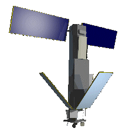

*Skywatching* como le llaman en el norte es la actividad de **observar el cielo** nocturno por fenómenos astronómicos como ver estrellas, planetas, lunas, cometas, satélites, satélites artificiales, y cualquier otra cosa que capture nuestro interes.

Como no tengo un telescopio, y como no deseo quedarme afuera, decidi ponerme a buscar qué cosas podría ver más o menos a simple vista. Encontre varias cosas:\

- \
- Estrellas brillantes y visibles a simple vista.\
- ISS o Estacion Espacial Internacionál.\
- Iridium Flares o bengalas Iridium.\

Las estrellas más brillantes son fáciles de identificar, **son las más brillantes** (obvio) y es lo que todos tipicamente observan. Es interesante pues uno puede observarlas a simple vista, e ir aprendiendo las formas de las constelaciones. Más adelante, podremos usarlas como puntos de referencia para movernos por el cielo con la vista y encontrar otras estrellas menos visibles u otros objetos. Personalmente comenze a familiarizarme con el cielo gracias a un mapa gratuito que mes a mes bajaba desde [Skymaps.com](http://www.skymaps.com/downloads.html).

Más interesante aun resulta la [Estacion Espacial Internacíonál](http://www.shuttlepresskit.com/ISS_OVR/) (ISS en sus siglas en ingles). A la fecha es el objeto terrestre creado por el hombre más grande en el espacio... algo digno de verse. Desde la tierra no es visible pues no tiene luz propia como las estrellas, pero en ciertas ocaciones refleja la luz del sol. Es bastante dificil de dar con ella pues tiene una orbita baja, lo cual causa una pequeña fricción contra la atmósfera terrestre que la frena y altera su orbita, con lo que de ves en cuando encienden los motores orbitales para corregir la trayectoria. Sin embargo hay formas de calcular dónde aparecera, solo que con pocos días -u horas- antes y no con años como sucede con las estrellas y planetas. La página [Hevens-Above](http://www.heavens-above.com/) ofrese un servicio gratuito excelente de predicción para la ISS, entre otras cosas.

Finalmente una de las cosas que más curiosidad me produjo fueron las [Iridium Flares](http://www.assa.org.au/observing/iridium/) (bengalas o chispasos Iridium). Resulta una historia muy interesante. En el año 1998 la empresa **Iridium Corporation** finalizo de lanzar un conjunto de satélites de comunicación de telefonía celular. El conjunto constaba originalmente de 88 satélites de los que actualmente quedan algo más de 62. Pero no funciono economicamente y en septiembre de 2001 fue comprada por la empresa [Iridium LLC](http://www.iridium.com/).\
La configuracion de las antenas de estos satélites hace que en determinadas ocaciones la luz del sol se refleje a la tierra por unos segundos, y un obsevador bien hubicado podria ver un [flare o bengala](http://antwrp.gsfc.nasa.gov/apod/image/9804/iridflare_dorreman_big.jpg) muy intenza (hasta magnitud -8) en el cielo nocturno.

\
*Satélite Iridium. Las tres antenas inferiores son las causantes de los reflejos. Pueden ver fotos detalladas de los satélites [aquí](http://www.obsat.com/irimage_e.html).*

Debido a que los reflejos no dependen esclusivamente de la pocición del satélite, sino de la convinacion de su posición y la del observador, hay que realizar ciertos calculos para poder predecir donde y cuando se podra ver uno. Como mencione anteriormente, la página [Hevens-Above](http://www.heavens-above.com/) ofrese un servicio gratuito excelente de predicción de Iridium Flares.

Lo más interesante que ofrese [Hevens-Above](http://www.heavens-above.com/) es la posibilidad de subscribirnos gratuitamente al canal [AvantGo](https://my.avantgo.com/browse/0/3121/) y bajarnos periodicamente las predicciones a nuestro handheld.

\
Sin más escusas... a disfrutar del cielo!
