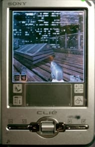

La palm es una cosa que no deja de maravillarme. Mientras que la gran mayora de la gente parece creer que no son más que versiones sofisticadas de las viejas agendas digitales; la realidad es que son poderosas computadoras que solo estan limitadas por la imaginación e ingenio del usuario.

Una muetra más de lo que afirmo es esta aplicación creada por [JonoF](http://jonof.edgenetwork.org/index.php?p=jfduke3d), y adaptada por la gente de [metaviewsoft.de](http://www.metaviewsoft.de/en/Software/PalmOS/Freeware/Duke3D/index.html) para PalmOS.

\
*Duke Nukem 3D en mi palm!*.

Lo más interesante es que esta no es una version del Duke Nukem 3D para palm... ES el Duke Nukem 3D!\
De hecho para poder jugarlo en la palm necesitamos dos cosas:

- \
- [Duke3D](http://www.metaviewsoft.de/en/Software/PalmOS/Freeware/Duke3D/index.html), el port para palm.\
- Los archivos originales del juego (tambien pueden ser los de la demo).\

Necesitamos ademas contar con una tarjeta de memoria, más o menos 25 megas libres, y que la palm tenga suficiente memoria virtual. Todas las instrucciones, y estos aspectos técnicos estan mejor explicados [aquí](http://www.metaviewsoft.de/en/Software/PalmOS/Freeware/Duke3D/index.html).

Es muy curioso que como se trata de un juego relativamente viejo (fue lanzado por 3D Realms en 1996) la resolucion de los gráficos es de asombrosos 320x200. Esto es muy interesante pues resluta que mo palm tiene una resolucion de 320x320, y el juego corre a las mil maravillas. Uno esperaria que corriese un poco más lento en la palm, pero no es el caso. Ademas el uso de energía es de lo mas adecuado. A pesar de cargar el juego desde la memoria externa (algo que tradicionalmente consume bastante energía) lo corren en la memoria interna, por lo que he logrado jugar por casi una hora y media con una sola carga de pila.

El Duke Nukem 3D, tiene su historia. Fue el ultimo gran juego en 2.5D (una tecnología que era más que 2d pero menos que 3d). Luego surgieron los primeros engines verdaderamente 3D y la tecnología gráfica de las pc se disparo.\
Pero a pesar de los cambios, el Duke Nukem 3D sigue siendo un objeto de culto para muchos. En gran parte por su caracteristico humor. Por ejemplo, 'hay un arma que encoje a los enemigos, y si Duke camina hacia ellos los puede pisar. Hay un codigo que permite lanzar dinero, y si se lo dan a una de las bailarinas en el juego, estas comienzan a bailar. Y como olvidar frases como:\

- "Eat shit and die!"\
  "Come get some!"\
  "What are you waiting for ... Christmas?"\
  "Hehe, what a mess."\
  "Your face, your ass, what's the difference?"\
  "I'll rip your head off and shit down your neck."

Si como yo, ya lo estan bajando a su palm, no se olviden de los viejos cheat code, para ser inmortal y tener todas las armas, jejeje:

- **Cheat Codes:**
- dncornholio o dnkroz - Modo Dios.
- dnstuff - Todas las armas, municiones, llaves e inventario.
- dnunlock - Habre todas la puertas.
- dnscotty### - Nos lleva a otro nivle (el formato es \[# de episodio\]\[numero de nivel\]. Ej.: 305).
- dnending - Nos lleva al ultimo episodio.
- dnclip - Activa o desactiva el atravesar paredes.
- dnshowmap - Muestar todo el mapa del nivel.
- dncashman - Al precionar espadio
- dnview - Cambia el punto de vista del personaje.

(Hay más claves, pero estas son las más utiles).

Mientras viajo en el bondi a la facultad, otros juegan al tetris en el celular.... Yo mato aliens en 3D. Vamos las palms Carajo!
