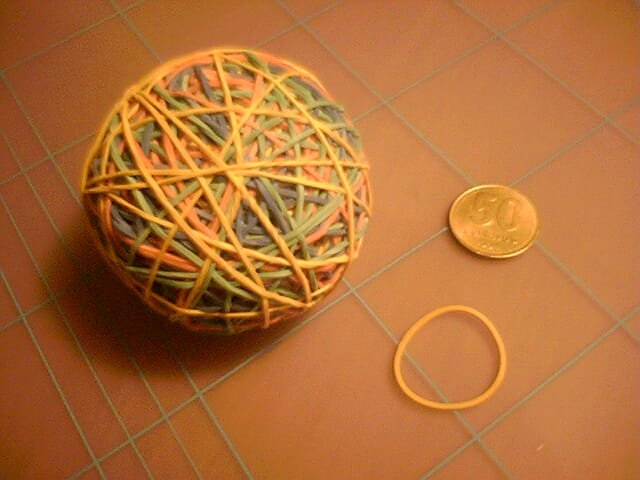

Cada año llega esta fiesta y me enfrento al mismo problema. Uno creeria que el día del padre seria más fácil que navidad por ejemplo, pero por el contrario. En navidad las tiendas no solo liquidan el stock de un año, sino que tambien ofrecen una gran variedad de artículos para toda la familia, sexo y edades. En contraste, en el día del padre se hace dificil encontrar ofertas más originales que una afeitadora, un perfume o una camisa cara. El fin y al cabo.... cuantas afeitadoras puede necesitar un padre?

Un recurso al que le he hechado mano en los ultimos años, a sido los regalos caseros. Nada expresa tanto amor como una *linda porqueria hecha con las manos*. Claro que con mis 26 años ya estoy muy grande para jugar con arcilla, o dibujar en crayones. Ademas, el sentimiento del regalo es el esfuerzo que uno invierte en él, tanto sea por idearlo, crearlo, o elegirlo. Entonces no hace falta que sea algo muy elegante o complicado. Basta con que este bien elegido.

A mi padre -como a mí- nos gusta dibujar. Asi que un rápido paseo por las librerias me bastan para encontrar alguna birome o portaminas interesante. Pero claro, ese regalo, si bien es apropiado, no transmite el sentimiento que deseo hacer llegar a mi padre, asi que ¿qué hacemos?

Este año decidi regalarle una pelota de gomitas elásticas. Lo vi en uno de mis viajes. Es -simplemente- de una *pelota de gomitas elásticas*.\
La gracia ademas de la obvia (esta genial, es una pelota de gomitas!!), es que -al menos yo- no he visto este artículo en ninguna libreria (tampoco es que alla revisado mucho), asi que es bastante unico.

 *Pelota de gomitas de colores. Al lado una moneda de 50 cts. y una gomita suelta.*

Una caja de 100 gr. de gomitas, una pelota de telgopor de 20 centavos, y 2 hs. de trabajo fueron suficientes para obtener este lindo regalo. De buen peso y colorida, es un interesante tema de conversación.

En otras palabras una *linda porqueria hecha con las manos*. **Feliz día pá!**
