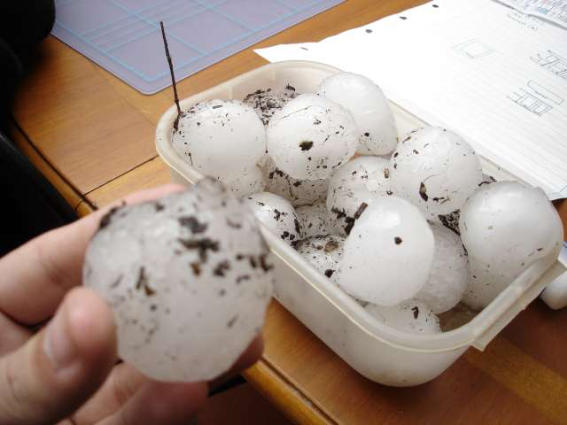
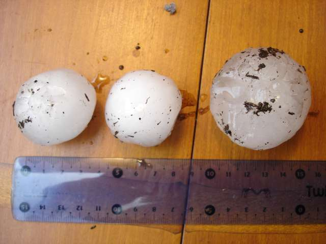
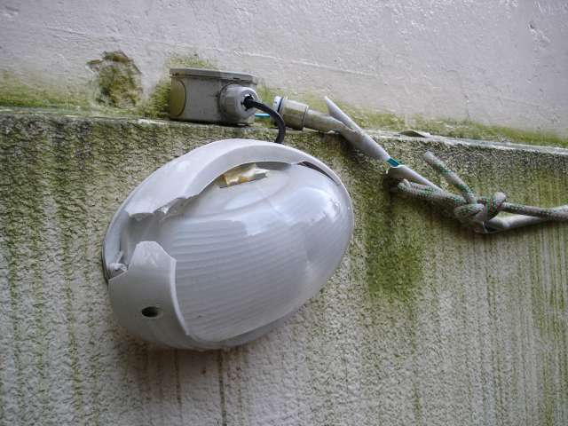

Estaba yo sentado en cerramiento de mi patio, donde suelo trabajar en la computadora, cuando oi un estruendo tan fuerte y cerca a mi cabeza que lo unico que atine a hacer fue saltar y refugiarme detras de la cama. "Finalmente, ocurrio, estan tirando grandas." pense. Pero reflexione y era poco probable. "Quiza se trate del vecino del 7mo que otra ves esta tirando petardos por el balcon." me dije. Mientras estas ideas pasaban por mi mente el cielo comenzo a caer. En ese monento me di cuenta de que eran las 4 de la tarde y que, aun en invierno, a esa hora no podia estar tan oscuro. Una miríadad de bolas de hielo tapizo de blanco las calles y así, sin previo a viso, comenzo la más extensa y larga lluvias de granizo que la ciudad de Buenos Aires ha visto.

 *Algunas muestras del granizo que golpeo mi techo.*

Con un tamaño de casi 5 centímetros y medio , el granizo que cayo en mi caza, esta apenas 1 centimetro y medio detras de los trosos más grandes que se registraron.

 *En esta foto pueden apreciar el tamaño del granizo.*

No he podido determinar la fuerza en que golpearon el techo, pero fue suficiente para hacerle grietas de impacto en el policarbonato celular (es un tipo policarbonato de 3 capas con camaras de aire rectangulares a lo largo). Para que se den una idea el policarbonato de este tipo es 200 veses más resistente que el vidrio.Tambien quebro algunos apliques de luz exteriores y lastimo algunas plantas.

 *Algunos daños a causa del granizo.*

En medio de mi asombro y en vista de lo histórico del acontecimiento tome rapidamente mi cámara de fotos digital y grabe un video de casi un minuto de largo documentando tan extraño acontesimiento. Se puede apreciar claramente la fuerza de los impactos y el estruendo que producian en el techo de policarbonato, que debido a su flexibilidad aumentaba el sonido como un tambor gigante.

[Ver video en YouTube](https://youtu.be/AcXOQkygB1s)

Los noticieron hicieron repercución de este fenómeno climático, que si bien estaba anunciado como alerta meteorilógica nadie esperaba que llegara a granizo, como lo hizo. Por las pantallas de tv desfilavan interminables proceciones de automóbiles abollados, lunetas destrozadas y vidrios partidos. Incluso hubo casos de derrumbe en algunos estasionamientos descubiertos, debido al peso que se acumuló sobre la media-sombra (un tipo de techo de tela sintética que tienen los estasionamientos para reducir el impacto del sol en los coches), que termino por tirar medianeras sobre los autos. A las pocas horas luego del granizo, las casas de reparacion de cristales automotores ya tenian una lista de espera de varios meses.

Por mi parte, auto no tengo, y los años en mi casa fueron mínimos. De hecho ahora le tengo mucha más confianza al policarbonato que antes, si se banco el granizo, ahora me voy de vacaciones tranquilo. Los que me conozen saben que cuando llueve no salgo a la calle ni para sacar la basura asi que a diferencia de mies de argentinos el granizo me agarro a salvo en mi casa, por lo que pude disfrutar de un espectáculo como pocas veses he visto (tampoco salgo mucho, se nota?).
