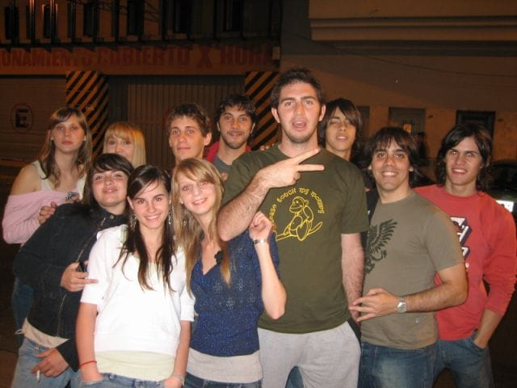
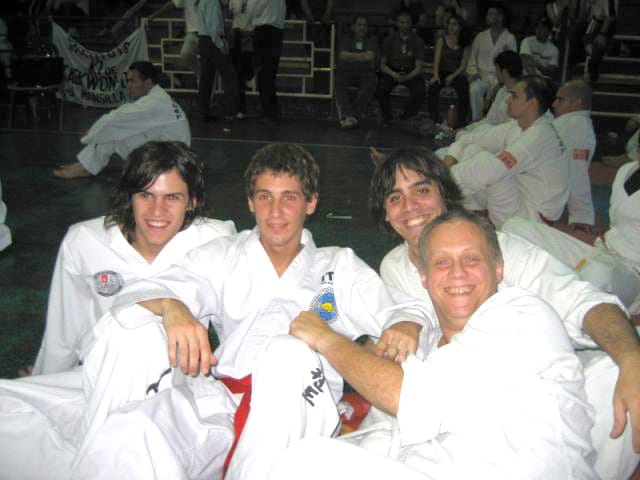
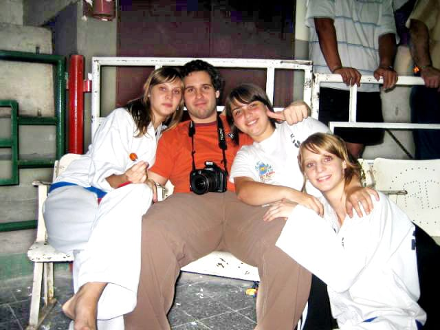
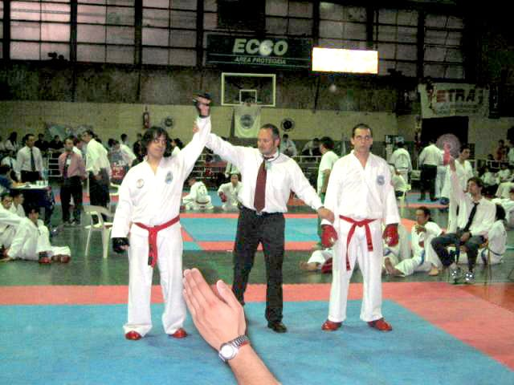
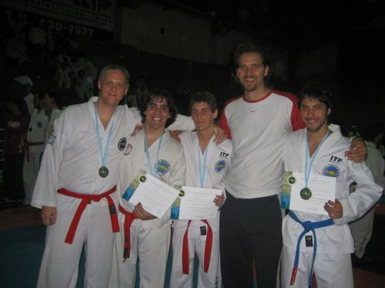
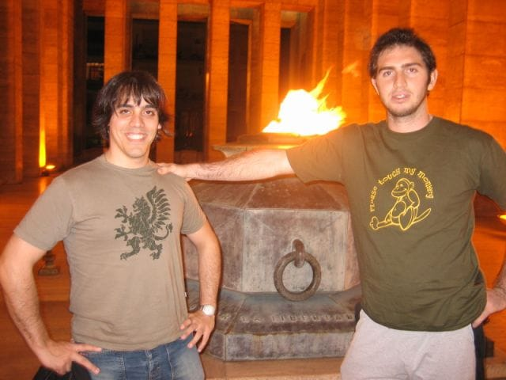
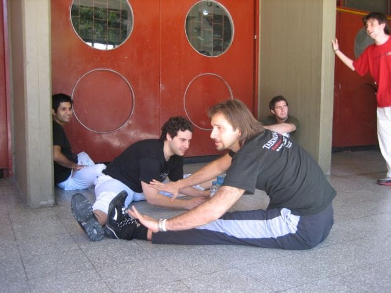

Así es. Tal como dice más arriba. Sali segundo en lucha en la categoria de más de 80 kilos, en el Torneo Nacionál en Rosario organizado por la Federacion Latinoamericana de Taekwon-Do (FLT-ITF).

*La muchachada.*\

 *De izq. a der.: Ale, Guido, yo, y Claudio. Cada uno en una categoria diferente. Antes de entran en calor.*

 *Las chicas. De der. a izq.: Melody, el Sabom Gabriel, Mechi, y Dechu. Todos compitieron, menos Mechi por una lección. Eso no impidio que viniera a alentar a todos!.*

 *Aca ya gane el primer combate.*

*Al terminar los combates recivimos las medallas y los certificados. Todos ganamos en nuestras categorias. Genial. El hombre alto, -altísimo- es nuetstro Sabonim (profesor) Hernan Cisternas que nos acompaño como couch todas las peleas.*

 *Esa noche fuimos a festejar y hacer un poco de turismo por Rosario. Esta foto mia con Fede, es en el monumento a la patria.*

Al volver al hotel, los Danes (cinturones negros) se fueron a dormir pues competian al dia siguiente. Los Gups (colores) nos fuimos de joda. Obvio. Fuimos a una casa de video juegos y nos pasamos 3 horas en el pool, el tejo y el metegol (lo mejor). Lo pasamos bárbaro. A eso de las 3 pinto ir a vailar, pero una de las chicas era un poco joven (no mucho) y como no conociamos los boliches de la zona no estabamos muy seguros de llevarla.\
Asi que, como la idea era divertirnos todos juntos, nos quedamos en el hotel a comer helado (que estaba horrible) y a ver las peleas del día en la filmadora en el cuarto de las chicas...buenísimo. Nos reimos un montón, y ademas fue muy lindo compartir esa noche todos juntos.

*Al dia siguiente fue el turno de los Danes. Luego de un buen desayuno, llegamos todos al torneo, y comenzaron a calentar tranquilamente.*

-------------------------------------

Si quieren ver, les dejo mis dos combates (una pelea, y dos peleas en la final) que baje con poca calidad de la filmadora.

[Ver video en YouTube](https://youtu.be/ODJTwdqgUdc)

Despues, cuando consiga, les muestro más -y mejores- fotos de todos los chicos. Un saludo!
