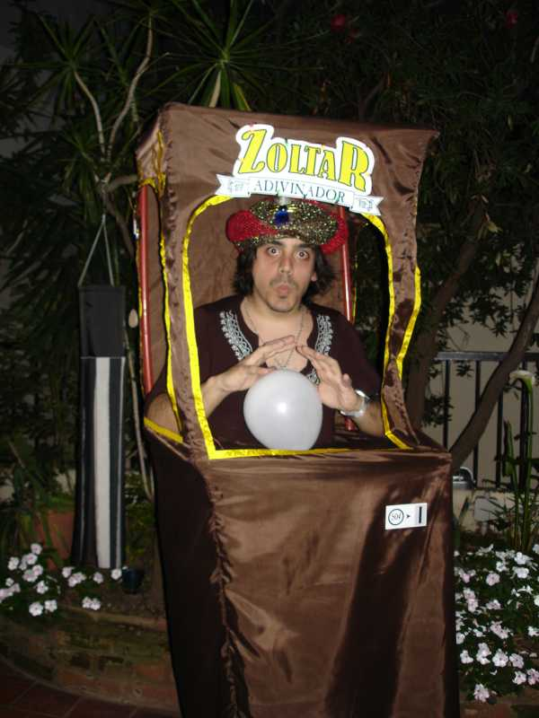
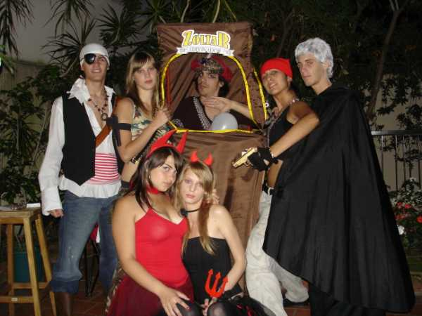
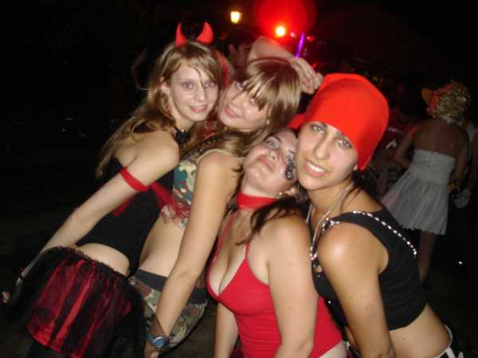

El sábado 21 fue el cumpleaños del primo de un amigo...y fuimos todos los chicos y chicas de tkd. Fue una fiesta de disfraces en una quinta. La pasamos genial.

*Aca estoy yo. "ZolatR el Adivinador"*\

Yo tenia guardado una idea de disfraz desde hacia mucho tiempo y decidí que era ahora o nunca. Fui disfrazado de máquina adivinadora, como la de la película de Tom Hanks "Quisiera ser grande". Me arme un arnés.. cosí toda la tela, y me arme el disfraz. Aun que no lo parezca, fue relativamente simple y muy cómodo de llevar. Baile toda la noche con el disfraz puesto.

 *De der. a izq.: Gandalf (aka Guido), Pandillera (aka Nadia), ZoltaR (aka, Lucas), Guerrera (aka Melody), Pirata (aka Ale), Diablita 1 (aka Dechu), y Diablita 2 (aka Mechi).*

Nos juntamos todos a hacer la *previa* en mi casa. Desde las 10 ya estábamos chupando, jajaja. Pudimos ver los disfraces de cada uno y sacarnos un montón de fotos (más de 200!).

Llegamos a la fiesta a eso de las 2:30 de la mañana ya medio enfiestados todos... jajaja. Al final fuimos los mejores disfrazados, y los que más onda le pusieron. Nos bailamos todo Las chicas estaban..., como estaban!! Fíjense:

 *Las chicas!!!*

Nos fuimos a eso de las 7 de la mañana ya estaba aclarando y todo. Medio en pedo, medio dormido... no se ni como llegamos cada uno a su casa. .. Bueno, si se. Nos repartimos en auto y Claudio -que tiene más aguante al alcohol que todos nosotros juntos- se aseguro de ir llevando a cada quien a destino.

Personalmente fue una noche extraña para mi... bailar con la carpa no fue particular mente difícil, mucha gente venia a sacarse fotos y a preguntarme el futuro (conté como 25).\
Baile con algunas chicas... mechi me agarraba a traición y me sacudía la carpa (que mal que sonó), *me sacudía el disfraz*. :P

Charlando con los amigos, parece que hubo mucho quibombo con las chicas. Es que estaban de infarto, no las culpo. Pero el boludeo esta bien hasta cierto limite. Después o se corta o se va a algo más serio.

Francamente, no se de que se quejan.....

-ZoltaR-
