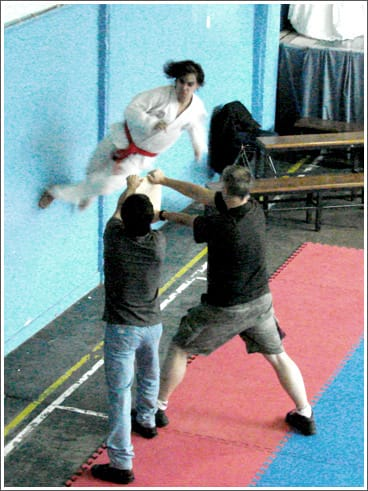
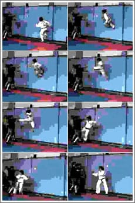
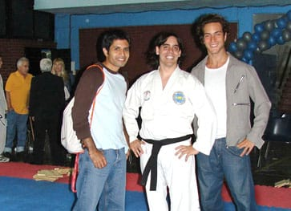

Hace algunas semanas rendi mi examen para cinturon negro de Taekwon-Do. El grado oficial es de 1º Dan, que es el primer nivel de los 9 que son. Con este grado, estaria habilitado (con permiso de mi profesor, por supuesto) de dar clases y tener mis propios alumnos. Empece a practicar hace ya 12 años y tube algunas idas y venidas, pero finalmente llegue al cinturon negro.

[Ver video en YouTube](https://www.youtube.com/watch?v=)

\
*Rotura de habilidad: Patada circular a la cabeza, luego de caminar por la pared 3 pasos.*

\
*Aca pueden verme en plena caminata por la pared dando el segundo paso.*

\

\
*Secuencia de la rotura de habilidad.*

\
El examen fue muy bueno. Me lleve la mejor nota de los cinturones de color (7,75/10), pero quiza lo más memorable fue que vinieron a verme practicamente todos mis compañeros y amigos de TKD. El examen -que duro casi 3 horas- comprendio un examen teórico, y luego (de a dos parejas) pasamos frente a la mesa examinadora. Nos pidieron mostrar distintos ejercicios, tecnicas de agarre, de ataque de uno y tres pasos, tecnicas especiales como giro talon a la cabeza, saltando hacia atraz), y lucha. Lo normal en este tipo de examenes.

Tambien binieron a verme mis padres. Eso fue muy especial porque por lo general es complicado que los padres puedan venir a ver un examen o un torneo (en vivo, quiero decir).

Finalmente me saque una foto con mis dos **mejores amigos** con quienes ya llevamos años compartiendo el taekwon-do, entre muchas otras cosas.

\
*De der. a izq.:Tomás (3er DAN), Yo (1er DAN), y Julio (2do DAN). Los grados de DNA (cinturón negro) se cuentan desde 1er DAN (principiante) a 9no DAN (avanzado*).

Y si a alguien le interesa, aca les dejo mi tesis para que la lean: [Tesis_TKD_Lukas238.doc \[200 kb\]](https://docs.google.com/document/d/1rCWJz6sMqJ3hdc63RGWw7x2LgTE5PGwF/edit?usp=sharing)

EOF
