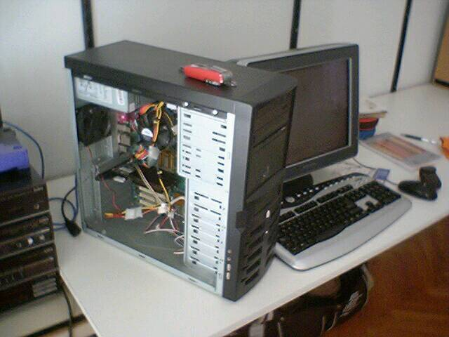

Hoy comienzo un nuevo trabajo. Casi dos meses tarde en consguirlo y fui a 6 entrevistas, subi un curriculum a mi web y arme un portfolio.\
Es en una agencia de publicidad dirigida por dos profecionales (campañas publicitarias, estrategias de marketing y la compra de medios) y que ahora estan incursionando de lleno en el area web y multimedial.

Aparentemente más de 250 personas contestaron su anuncio, de los que seleccionaron a 10, y finalmente quede yo. Supongo gusto la variedad y calidad (?) de mi portfolio, donde presente desde trabajos graficos, presentaciones en flash, videos 3D con effectos especiales, hasta sitios web dinamicos en flash y PHP. Y era justo lo que buscaban, alguien con el conocimiento para poder saber de antemano que tan dificil puede llegar a ser un proyecto. La verdad es que no creo que me detaque particularmente en ningun aspecto, más alla de que me manejo con bastante comodidad en todos los aspectos del diseño multimedial, desde lo referente al diseño puramente estetico y/o gráfico hasta los aspectos más complejos de la programación y bases de datos.

El primer dia encontre mi nueva PC en su caja. Ya venia instalada y por supuesto la formatee y reinstale el sistema desde cero. Nueve horas despues nacia una nueva y mejorada PC.

Tambien revice el hardware. ;)

En este momento estoy en un periodo de ajuste. Familiarizandome y organizando el material de trabajo. Pero ya tuve oportunidad de subir a la web un par de correcciones menores.\
Tambien fui capas de aportar una solucion temporal al problema de la red de la oficina (que a pesar de compartir internet se niega a compartir el acceso remoto a archivos) ya que en mi PC al tener instalado un servidor (IIS 5.0)eso me permite 'servir' una carpeta por acceso FTP, con lo cual solucionamos el problema temporalmente.\
\
Ahora solo queda familiarisarme con loa clientes actuales (los archivos, no las personas) y listo.

Me gusta este trabajo, me da la oportunidad de perfeccionarme, y al quedar cerca de lo de mi vieja tengo la excusa perfecta para ir de visita.

\[palm:Blogged\] - Colectivo 152
