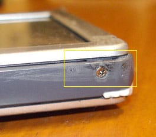
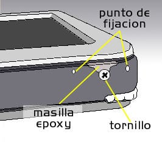
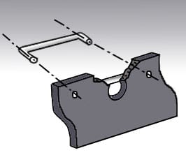

Hace un par de días desperté a la mañana y en lugar de atinarle al despertador le atine a la palm, la cual cayo al suelo golpeándose fuertemente en una esquina, junto a uno de los tornillos que fijan la carcasa. Si bien la palm aun funcionaba sin problemas, la carcasa quedo medio abierta ya que el golpe había quebrado una pieza de plástico a la cual se fijaban los tornillos.

Pasaron algunos días para que encontrara la forma de reparar el daño de forma duradera. Mi idea inicial era reconstruir las partes de plástico dañadas con [masilla epoxy](http://es.wikipedia.org/wiki/Resina_epoxi) y aunque esta es una forma practica de reparar el daño estético, la masilla por si sola -y en parte debido a la forma y lugar del daño- no seria suficiente para resistir las tensiones que los tornillo irían a ejercer durante el uso diario de la plam.

*Detalle de la palm reparada.*

Así que recurrí a un viejo truco que siempre uso con mucho éxito. Reforcé el área con una pieza de metal, concretamente con un pequeño trozo de ganchito de abrochadora.

*Detalle de la reparacion.*

El truco consiste en crear un surco en el plástico -con un alfiler calentado al rojo vivo en una vela- para crear lugar en donde anclar la pieza de metal. En la imagen anterior pueden ver los puntos de fijación que son pequeños agujeros perpendiculares a la fuerza que pretendo resistir -en este caso el tornillo que hará fuerza hacia arriba- de forma que la tensión no deba ser resistida solo por el pegamento o la masilla epoxy, sino por el mismo plástico de la carcasa al cual esta anclada la pieza de metal.

*Pieza de metal anclada perpendicularmente a la fuerza a resistir.*

Ahora mi palm esta feliz igual que yo, y en un muy buen estado.
