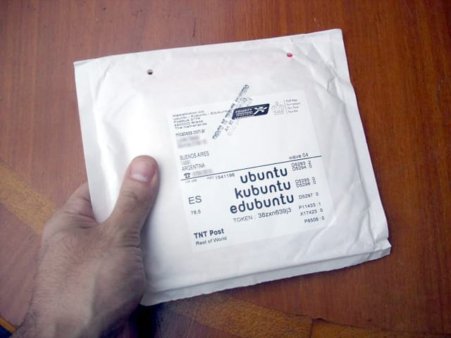
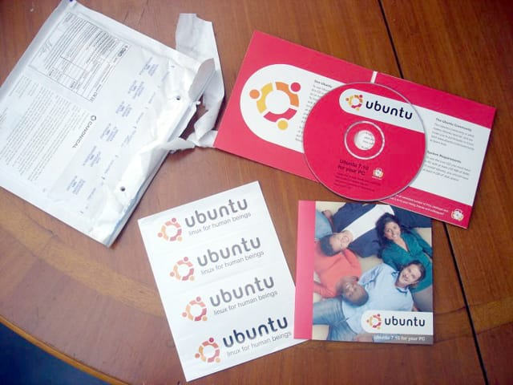

Ayer en pleno sábado por la tarde llegue a casa y encontré bajo mi puerta un paquete.

\
Resultaron ser mis dos CDs de la distro de Linux Ubuntu que hacia un mes que pedí por ship-it en la página de Ubuntu.

Hace mucho que quiero incursionar en linux. Lo más cercano que llegue fue una distribución de Linux Suse -o algo así- que luego de instalarse se borraba de la máquina al reiniciar. además nunca pude montar la disquetera mucho menos usar internet... y al final me rendí.

El paquete contenia los dos CDs y cuatro stikers con el logo de Ubuntu... Creo que ahora si me animo a reintentarlo. Mi idea es conseguirme una PC vieja una Pentium 3 donde instalar Ubuntu y migrar el servidor web que actualmente corro sobre IIS -en mi PC- a Apache, ademñas de otros servicios, y por supueto ponerla como servidor de red e internet. Quiza también como contestador telefónico.. en fin.

Tener una segunda máquina donde experimentar con linux es uno de mis sueños, si además esa máquina funciona en algo útil... grandioso!

Recibir estos CD m hace sentir más cerca de la comunidad global... El resto del mundo existe... y no solo en internet.
