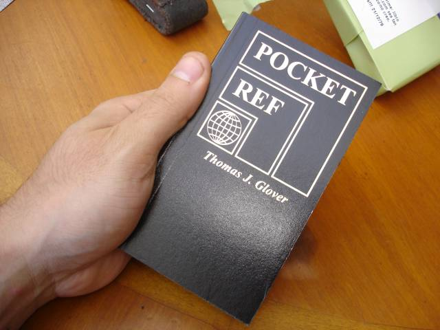

Hoy por la mañana llegó -de forma inesperada- un paquete a mi nombre y resultaron ser los libros que compre en [Amazon](http://www.amazon.com/).

Uno de ellos es el [**Pocket Ref** de *Thomas J. Glover*](http://www.sequoiapublishing.com/pdt_pocketref3ed.htm). No puedo creer que al fin lo tengo en mis manos. Lo vi por primera ves hace como un año en el blog de la revista Make, que trata de todo lo relacionado con el DIY ("***D**o **I**t **Y**ourself*", o *hagalo usted mismo* en español).

Se trata de un manual de referencia lleno de informacion sobre el aires, pegamentos, pinturas, madera, metales, plomería, conversión de unidades, etc... hasta la capacidad de las baterías, el área de los polígonos, composición elemental del cuerpo humano, números de teléfonos internacionales, y más.

El paquete de Amazon fue enviado desde Alemania y me sorprendio su llegada pues la fecha estimada era para el 28 de diciembre. La segunda sorpresa fue que tanto en Amazon como en la web del autor decian que solo estaba disponible la 2da edición, y que la 3ra aun estaba en preparación. Adivinen cual edición me llego... si dijeron la 3ra adivinaron!!

Por *supuesto* -y como ya es costumbre cuando compro libros- lo pedi envuelto para regalo. Y Amazón incluso me permitio escribir y adjuntar una tarjeta.

La tarjeta que me escribi dice:

> "De Lukas238\
> Para Lucas!

Espero que este mi primer libro comprado en Amazon.com sea tan útil e interesante como creo.

Feliz cumpleaños!!! 21/12/79"

Cuando escribi el mensaje no me di cuenta que puse mi fecha de nacimiento (1979) en lugar de la de mi cumpleaños (2007). Y bueno, era de madrugada, jajaja.

\
Pocket Ref fue presentado en la serie de televisión [Mythbusters](http://en.wikipedia.org/wiki/MythBusters) (*Cazadores de Mitos*, por el canal de cable [Discovery Channel](http://www.tudiscovery.com/cazadores_funsite/) en Argentina).

> "It's got everything in it.... It should be in everyone's toolbox." *Adam* (*Tiene de todo... Todos deberían llevar uno en su caja de herramientas*)

\
**Tabla de Contenidos:**

- Prefacio Introducción de información personal y de nombres comerciales, marcas, y Referencias
- Aire y Gases
- Composición del Aire
- Propiedades físicas del aire
- Densidades de Gases
- Definición Estándar Ambiente
- General leyes Gas & fórmulas
- Densidad del aire húmedo
- Elevación vs Aire y Agua Propiedades
- El calor específico del aire seco & Sound Velocity al 1 Ambiente para diversas Temperaturas
- El calor específico del aire seco a 20 ° C constantes de temperatura y diversas presiones
- Air herramienta CFM & PSI requisitos
- CFM vs ISP para diversos tamaños de boquilla
- Manguera de aire a presión y la pérdida de fricción
- Línea Aérea recomendó tamaños
- Air receptor de la capacidad
- La contaminación del aire los límites de seguridad
- Automotive
- Cuadro Anticongelante
- Bujía bujía
- Batería de plomo ácido gravedad específica / cargo
- Aceite de viscosidad vs temperatura
- Auto faro de alerta
- Automotive Air Conditioning
- Automotive cableado eléctrico
- Tire tamaño vs Carga
- Tire fabricante códigos
- Tire tamaño de codificación
- De carga vs pliegos de estrellas
- Fórmulas Automotive
- Carpintería y Construcción
- Dimensiones de madera blanda
- Madera blanda de clasificación
- Hardwood Lumber tamaño y grado
- Wood contenido de humedad
- Plywood y panel de clasificación
- Características Wood
- Valor de los materiales de aislamiento
- Máximo palabra viga atraviesa
- Douglas Fir - Grupo de alerce
- Hemlock, - Grupo Fir
- Spruce - Grupo Ping
- Southern Pine grupo
- Redwood Grupo
- Fuerza de vigas de madera
- Encolado de madera características
- Concrete
- Mortero
- Química y Física
- Elemento Cuadros
- Elemento Propiedades
- Tabla Periódica de los Elementos
- PH de común Ã�cidos
- PH de Bases comunes
- Indicadores de pH
- Elementary Particles
- La mitad de radioisótopos vida
- Uranio - 238 Decay Series
- Serie galvánica de los metales en agua de mar
- Computadoras
- Computer códigos ASCII
- IBM PC mapa de memoria
- IBM PC interrupciones hardware
- Serial Ports
- Canales DMA
- Megabytes y Kilobytes
- Constantes - Física, Química y Matemáticas
- \- Electrical Wire, Motors y Frames
- Hilo de cobre capacidad actual
- Ampacity frente a la corrección de temperatura
- Copper Wire actual de plazas (3 alambre)
- Standard & Lamp cable de extensión actual de las capacidades
- Alambre de aluminio Amp capacidad
- Ampacity vs Temp. Corrección (Al)
- Aluminum Wire Amp Capacidad (3 alambre)
- Ajuste actual de más de 3 cables en un Cable
- Hilo de cobre de Resistencia
- Especificaciones Estándar cable de cobre
- Wire & clases de aislamiento
- Standard Wire códigos de color
- Wire tamaño vs caída de tensión
- Conduit tamaño vs tamaño de alambre
- Box Tamaño vs Número de cables
- Promedio motor eléctrico Especificaciones
- NEMA motor eléctrico Frames
- NEMA Electric Apéndice tipos
- DC Motor cableado Especificaciones
- 3 fases motor eléctrico Especificaciones
- HP vs Torque vs RPM para Motors
- Electrónica
- Resistor de códigos de color
- Resistencia de los valores estándar
- Los códigos de color de capacidad
- De capacidad estándar de los valores
- Piloto lámpara Especificaciones
- Discos de carga - pequeño tubo tipo
- Características de batería
- \- El tamaño estándar de baterías
- RF Coil Winding datos
- Wire Size vs Número de Activa / Inch
- Decibelios vs Voltage & Power Ratios
- Fórmulas de la Energía Eléctrica
- Información General
- Vacaciones
- Temporada & Clock fechas
- Signs of the Zodiac
- Flores para cada mes
- Birthstones
- Aniversario Nombres
- Papel Dimensiones
- Inglés - alfabeto griego
- Radio Alfabeto
- Código Morse
- "Diez" Radio Códigos
- Militares de rango y categoría
- Estado Información
- Datos climáticos EE.UU. en las ciudades
- Time Zones en los EE.UU.
- Zonas tiempo en el Mundo
- Teléfono códigos de área por ubicación
- Teléfono códigos de área por el código de área
- Las principales elevaciones Mundial de las líneas aéreas y los aeropuertos que los códigos de dos letras
- Aeropuertos en los EE.UU. con Elevation, Códigos de la ciudad y Poblaciones Nombre del aeropuerto
- Los principales aeropuertos mundiales y elevaciones
- Línea aérea códigos de dos letras
- Línea aérea 1-800 números de teléfono
- Perdió la tarjeta de crédito los números de teléfono
- General Science
- Conversiones de Temperatura - ° F ° C
- Sound Intensidades
- El cuerpo humano composición
- Peso Corporal vs altura
- Física Growth% - Boys
- El crecimiento físico% \$ - Girls
- Aceleración de la gravedad
- Fuerza del viento Escala Beaufort
- Wind Chill factores
- Heat - Humedad factores
- Leña / combustible de calor comparaciones
- Frequency Spectrum
- El Sol y los planetas de datos
- Geología
- Mineral cuadro abreviaturas
- Mineral Cuadros
- Elemento de óxido de las conversiones
- Minerales ordenado por densidad
- Minerales ordenado por la dureza
- El contenido metálico de los minerales
- A diferencia de color minerales
- Mineral Crystal sistema
- Elementos menores en las rocas sedimentarias
- Elementos menores en rocas ígneas
- Rocas ígneas Clasificación
- Rocas ígneas clases por Color
- Clases de rocas sedimentarias
- Las rocas metamórficas clases
- Geochemical inferior de los límites de detección
- Mohn escala de dureza
- Tamaño de las partículas descripciones
- Richter y Mercali terremoto escalas
- Especificaciones Core Drill
- Escala del tiempo geológico
- Glue, Solventes, Pinturas y Acabados
- Glue tipos y aplicaciones
- Los disolventes comunes
- Pinturas y Acabados
- Hardware
- Bolt Torque Especificaciones (pulgadas)
- Efecto de la Lubricación en Par de estrellas
- Bolt Torque Especificaciones (Métrico)
- Bolt especificaciones de par (Whitworth Std)
- Especificaciones de la madera tornillo
- Madera tornillo número vs tornillo longitud
- Sheet Metal Screw Especificaciones
- Fotografías de Jefes de tornillo
- Cable Cierres de alambre Rope
- Nails
- Fotografías de los tipos de uñas
- Matemáticas
- Prefijos numéricos
- Roman Numerals
- Convertir Inch - Foot mm - Drill \#
- Plazas, Cubos y Roots
- Grados, Radianes, Funciones y Trig
- Log, Log correo, Circunferencia, & Circle Area
- Derecho triángulo fórmulas
- Oblique triángulo fórmulas
- Avión cifra fórmulas
- Solid cifra fórmulas
- Mine, Mill y agregados
- Standard Sieve Series
- Mineral Dressing escala de calibrado
- Las existencias de volumen y peso
- Material de dumping ángulos
- Rock factores de carga
- Duración de Conveyor Belt en un Roll
- Transportador máximos ángulo de la pendiente
- Transportador de capacidad
- Transportador caballos de carga vs
- Jaw Crusher caballos de fuerza vs toneladas / hora
- Dinero
- Los tipos de cambio
- Descuento factores de valor actual neto
- Interés simple
- Interés compuesto
- Numerada Días del Año
- Plomería y Pipe
- Tuberías y tubos de cobre
- Plastic Pipe
- De tubos de acero
- De tubos de acero de fórmulas
- \- Presión de tubos de acero de Estrellas de Sch 40
- Cuerda, y la Cadena de Cable
- Rope (polietileno, de ñlon, manila)
- Wire Rope
- Cadena
- Pies de Cable o cuerda en una Reel
- Tirar de la fuerza frente a la pérdida de ángulo
- Acero y Metales
- Steel Wire Gauges
- Hoja de acero Galgas
- Dimensiones de placa de acero
- Wire y hoja de especificaciones
- Canal Acero
- Angle Steel
- Tee Acero
- Ronda de barras de acero
- Square barra de acero
- Hexagonal de barras de acero
- Octagonal de barras de acero
- Flat Steel
- Plaza de tubería de acero
- Rectangular tubería de acero
- Ronda de tubería de acero
- Tipos de Aluminio
- Topografía y Cartografía
- Porcentaje de grado a grado
- Cuadro estadios
- Las fórmulas para crear estadios de mesa
- Cartografía de las escalas y esferas
- Cuadro aparente Dip
- Tres punto problema
- La declinación magnética mapa
- Herramientas
- American National grifos y muere
- Métrico grifos y muere
- British grifos y muere
- British Association Standard Thread
- American Standard Taper Pipe Thread
- American Standard Straight Pipe Thread
- Agua Pesos y Propiedades de Materiales
- Pérdida de fricción en diversos Pipe
- Friction Loss cuadros
- Pérdida de fricción en accesorios
- Succión, Head & Vapor Prensa vs Altitud
- Horizontal tubería de descarga
- Boquilla de descarga
- Vertical tubería de descarga
- Weir aprobación de la gestión volúmenes
- Cilindro horizontal Fillage
- Cuadro vapor
- Contaminación del agua
- Dureza del Agua
- Agua de datos y fórmulas
- Pesas y Propiedades de Materiales
- Soldadura
- Arc electrodos de acero dulce -
- Electrodo Amperages
- \- Permitir que los electrodos de acero de baja
- \- Electrodos de acero inoxidable
- Marca de fábrica de electrodos de Conversión (Steel)
- Gas varillas de soldadura
- Gases de soldadura
- Hard y Soft soldaduras de aleación
- Solder Flux
- Templado de color de acero
- Tablas de Conversión
- 12 Año calendario perpetuo
- Index
- Notas de páginas en blanco y gobernantes

(Traducido con [traductor de google](http://www.google.com/language_tools?hl=en), ni me moleste en revisarlo.)

\
Ahora queda probarlo. Por lo que estube hojeando parece muy interesante, ahora queda ber si efectivamente es tan útil como parece. Los tendre informados.
