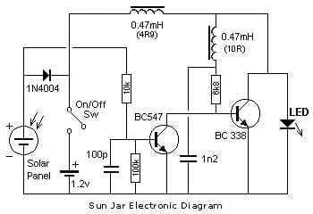
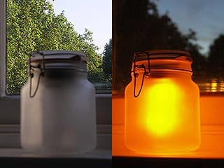

En Internet solo consegui [instrucciones](http://www.instructables.com/id/E3UXT5HGT7EUOJJIYE/?ALLSTEPS) para *adaptar un circuito* de *luz de jardín solar* comercial a un frasco. Y es que es muy buena idea de acuerdo a los precios en USA lo cual explica la dificultad de encontrar un diagrama del circuito electrónico.

Acá en argentina el tema es muy distinto. Una luz de jardín solar es un artículo de lujo, importado y de dificil obtención, por lo que segui buscando por la red hasta que encontre el circuito que estaba buscando, y lo comparto con ustedes.

**Listado de partes:**\

- \
- Diodo 1N4004
  \
- Inductor 0,47 (4R9)
  \
- Inductor 0,47 (10R)
  \
- Transistor NPN BC547
  \
- Transistor NPN BC338
  \
- Resistencia 6K8
  \
- Resistencia 10K
  \
- Resistencia 100K
  \
- Capacitador 100p
  \
- Capacitador 1n2
  \
- Switch On/Off
  \
- Led brillante
  \
- Porta pila AA de un solo elemento
  \
- Pila recargable AA
  \
- Panel Solar (de poco más de 1.2v)
  \

Un Sun Jar -como su nombre lo indica- es un *frasco de sol* o una trampa para el sol.

Consiste de un frasco esmerilado que debemos poner a la luz del sol durante el día, y a la noche podremos ver un tenue brillo dentro del frasco proveniente de la luz del sol *atrapada*.

El frasco contiene un pequeño circuito que -de día- carga una pila recargable, y cuando se hace de noche utiliza la energía acumulada para iluminar un pequeño LED amarillo, simulando la luz del sol. El circuito funciona automaticamente, solo debemos recordar ponerlo a la luz del sol durante el día y debería de proveer luz por casi 6 horas a la noche.
