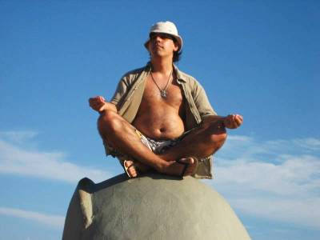

Hoy regrese de unas muy merecidas vacaciones en Punta del Este. Lo mio no es la playa careta ("Montoooya, gordo") sino la tranquilidad de la punta. Relajación y disfrute del mar, la arena, el sol y las noches frescas junto al malecón.

\
*Pose del buda. Sobre el dedo gordo de [La Mano](http://es.wikipedia.org/wiki/Imagen:La_mano.jpg) de Punta del Este.*

Nos movíamos a pie o en colectivo y las playas que más visitamos fueron:\

- \
- Parada 15 de la mansa (pasando los juegos acuáticos). Esta protegida del viento, no hay tanta gente, se puede hacer sandboard en los médanos y -lo mejor- se ve el atardecer (al rededor de las 9 de la noche) a un lado de la isla Gorriti.
  \
- Parada 2 de la Brava. Es el parador de la Olla, y aunque tiene buena música, por la cantidad de teens preferimos quedarnos a un lado. Hay bastante gente aunque no demasiada. Al pie del parador hay una escollera natural que proteje la playa y produce muy buenas olas.
  \
- Playa El Emir. Esta en la calle 27 y 28 sobre la brava. Es una pequeña playa protegida por una gran escollera rocosa. Al estar en medio de la punta es muy cómodo ir y volver a almorzar caminando solo un par de cuadras. Tiene excelentes olas y es una de mis preferidas.
  \
- La Barra. La playa de la barra comprende la salida del río Maldonado y la playa que se forma al mar. Es muy tranquila y casi parece una laguna. Esta llena de cangrejos y a pocos pasos de la costa ya es muy profunda. Es una playa amplia y tranquila. Y en medio del río hay un banco de arena que parece una pequeña isla seca.
  \

Todas las playas cuentan con salvavidas y puestos de panchos, choclos y bebidas lo que hace de ir a la playa una experiencia muy agradable y cómoda.

Cuando las tenga listas iré subiendo algunas imágenes más de mis vacaciones, así como también algunas fotos que tome explícitamente para fondo de pantalla (wide).

Un saludos a todos!!
