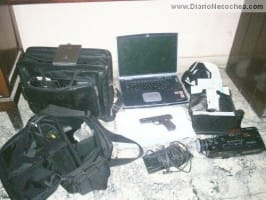

Hace un par de noches se produjo un robo en el campo **San Mariano** ubicado en el Cuartel II sobre la ruta 227, paraje **El Pampero**, Loberia. Yo me entero hoy a la mañana por mi padre quien es primo hermano de Mariano Otamendi -dueño de San Mariano- y que casualmente se encontraba en **Las Hachas**, campo inmediatamente vecino a San Mariano.

\
*Se recuperaron todos los objetos robados menos el efectivo y las armas.*

La nota publicada el 11/02/2008 en el [Diario Loberia](http://diarioloberia.com/articulos.php?Art=87&tabla=loberia) detalla los pormenores del robo y cómo se desarrollaron los eventos de esa noche que finalizaron en una persecución y huida de los maleantes.

> (...) al momento que se hallaba en interior de su vivienda cenando junto a sus familiares.- Momento en el cual irrumpen en la vivienda 4 sujetos del sexo masculino, encapuchados donde tres de ellos portaban **amas blancas y uno arma de fuego tipo revolver**, intimidando a todos e exigiendo la entrega de dinero en efectivo (...) sustrajeron la suma de 3500 pesos en efectivo un revolver tipo 357 mágnum un revolver de colección Cal. 32, una pistola marca COLT Cal. 380 y municiones varias correspondientes a las armas (...) una cámara digital, una filmadora, una computadora portátil, un portafolio , dos teléfonos celulares, y **un can cachorro Rotweiler**, (...) vehiculo marca SUBARU Ptte. EOL-097 y una camioneta marca TOYOTA Ptte. GES-071, en los cuales los sujetos emprenden rápidamente fuga, previo haber dejado **atados con precintos** a todas las personas en interior de la vivienda, **no llegando a lesionar a ninguna de ellas**.

A través de mis viejo me entero de otros detalle del robo:

- Se amenazó con secuestrar a una de las menores y pedir rescate desde el Uruguay, cosa que finalmente no se concreto.
- De los cuatro cacos uno tenia el rostro fuertemente cubierto y no hablo en todo el robo, dejando todo el trabajo en manos de sus compañeros. Se especula que pudiera tratarse de alguien a quien el dueño podría identificar.
- Por los comentarios y burlas de los cacos, donde preguntaban si seguía trabajando en el campo una persona determinada, se infiere que los cacos conocían el campo con anterioridad, incluso pudiendo haber trabajado allí.
- Los cacos detuvieron el auto del robo en el **"Camino Chico"** y cruzaron un potrero a pie al acercarse al casco del campo donde realizaron el robo.

[Ver contenido enlazado](http://maps.google.com/maps/ms?hl=en&ie=UTF8&t=k&s=AARTsJokeSHgRRLSkzj8mkGIlyT4__QYlQ&msa=0&msid=101176059659423603853.000446201521d37ef84ec&ll=-37.984934,-58.652401&spn=0.047355,0.051498&z=13&output=embed)

\
[View Larger Map](http://maps.google.com/maps/ms?hl=en&ie=UTF8&t=k&msa=0&msid=101176059659423603853.000446201521d37ef84ec&ll=-37.984934,-58.652401&spn=0.047355,0.051498&z=13&source=embed)
