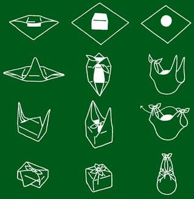

El [furoshiki](http://en.wikipedia.org/wiki/Furoshiki) es el arte de envolver objetos -ropa, bienes, regalos- en tela para su transporte. Comúnmente se usa para decorar regalos, envolviéndolos en un pañuelo de seda decorado de -generalmente- 45cm.

Más instrucciones: [link1](/assets/blog/legacy/furoshiki_1.jpg), [link2](/assets/blog/legacy/furoshiki_2.jpg).
