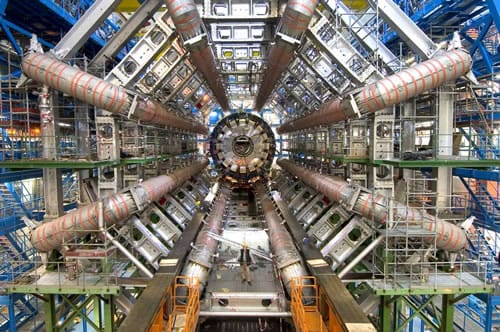

*Detector ATLAS. Fhoto: Maximilien Brice, CERN.*

**1. ¿Por qué se llama Gran Colisionador de Hadrones (Large Hadron Collider)?**

La primera es fácil. Se llama Gran porque es realmente enorme. EL LHC es un enorme túnel circular de 27 kilómetros de circunferencia, enterrado a una profundidad promedio de 100 metros de tierra y roca.\
En la física de partículas, el hadron es la familia de partículas subatómicas formada por los quarks y unidos por la llamada fuerza fuerte\*. Ejemplos de hadrones son los protones y neutrones. Como podrán adivinar el LHC usa mayormente protones (y algunos iones) para sus experimentos.

Por último, se llama colisionador porque el LHC acelera protones en dos rayos que viajan en direcciones opuestas y luego los colisiona para ver que partículas resultan del impacto.

> (\*) Existen cuatro fuerzas fundamentales de interacción en el universo: la fuerza fuerte, la fuerza débil, la fuerza electromagnética, y la fuerza de gravedad. Y a pesar de las elusivas observaciones de metachloritos por Quai Gon Jinn, (1999) Star Wars: Episode 1 - La Amenaza Fantasma, la existencia de "La Fuerza" permanece como una hipótesis controversial rechazada por la mayoría de los científicos modernos.

**2. ¿Por qué esta bajo tierra?**

Bueno, eso es porque 27 kilómetros de buena tierra a nivel del suelo es muy pero muy costosa. De hecho, el LHC usa un túnel que se escabo originalmente para un colisionador anterior (el LEP o Gran Colisionador de Electrones Positrones), el cual fue decomisionado en el 2000.

Toda esa tierra y rocas forman un excelente escudo que reduce la cantidad de radiación natural que alcanza a los detectores del LHC.

**3. ¿Por qué el LHC es como un Hombre Lobo?**

Porque ambos se ven afectados por la Luna. Como las mareas en los océanos, el suelo también esta sujeto a la atracción de la Luna. Cuando hay Luna llena la corteza de la tierra de hecho se levanta unos 25 centímetros. Este movimiento causa que la circunferencia del LHC varíe en un asombroso 1 milímetro, pero eso es suficientemente grande para que los físicos deban tomarlo en cuenta.

**4. ¿Por qué el LHC es como una heladera?**

El LHC no es solo un aparatoso y copado artilugio, es ademas muy pero muy frío. De hecho, es el sistema criogénico en el mundo. Y uno de los lugares más fríos de la tierra.

Para mantener los magnetos a temperatura de superconductor, los científicos tienen que enfriar el LHC hasta 1.9K (-271.3ºC), que es aun más frío que el espacio (-270.5ºC). Primero los magnetos son enfriados a -193.2ºC usando 10.000 toneladas de nitrógeno líquido. Y luego usando 90 toneladas de helio líquido logran bajar su temperatura a -271.3ºC. Todo el proceso toma un par de semanas.

**5. ¿Y qué es el CERN a todo esto.?**

En 1952, once países Europeos se unieron en el Concilio Europeo de investigación Nuclear (Conseil Européen pour la Recherche Nucléaire en francés, de ahí viene el acrónimo CERN).

Dos años después en 1954 se cambio el nombre por Organizaion Europea de Investigación Nuclear (lo que cambiaba el acrónimo a OERN). A nadie le gusto "OERN", así que siguieron llamándolo CERN.

Si el nombre CERN les resulta familiar incluso desde antes de oír hablar del LHC, es porque Internet fue creada por dos empleados de la CERN Sir Tim Berners-Lee y Robert Cailliau.

**6. ¿Cuanto cuesta, y quién lo esta pagando?**

El LHC llevó cerca de 30 años en crearse - y costo a los países miembros del CERN y a otros participantes un estimado de €4.6 billones (cerca de 6.4 billones de dolares).

Como en los infomerciales del canal LlameYa podemos decir "¡Pero eso no es todo!". Algunos agregado extra como los detectores, y la capacidad de computación, costaron un extra de €1.43 billones más.

**7. ¿Cuanta electricidad necesita el LHC?**

Se necesitan 120 MW para hacer funcionar el LHC. Para que se hagan una idea, 120 megawatts es igual a la energía utilizada por 1.2 millones de lámparas incandescente de 100 watts.

Se estima que el consumo energético del LHC en un año costara €19 millones.

**8. ¿Cuanta información se espera recibir del LHC?**

El experimento del LHC representa 150 millones de sensores enviando información 40 millones de veces por segundo. El flujo de datos es de 700 MB/s, o más o menos 15.000.000 GB (15 petabytes) por año. Si pusieran toda esa información en CDs los apilaran, tendrían una pila de 20 kilómetros por año!. Quizá sea mejor usar DVDs, asi solo necesitariamos 100.000 DVDs al año.

Para poder analizar la información, el CERN creo la Worldwide LHC Computing Grid - una especie internet privada y super veloz, que conecta 80.000 computadoras.

**9. Todo muy lindo, pero ¿creara el LHC un agujero negro que se tragará mi planeta?**

Siempre que los científicos crean un acelerador de partículas, aparecen aguafiestas y fatalistas prediciendo el fin de la Tierra en manos de agujeros negros, stranglets asesinos, monopolos magnéticos, o burbujas de vacío.

Hablemos un poco de cada uno:

- **Micro agujeros negros:** Son en escencia una región del espacio donde la gravedad es tan poderosa que nada, ni siquiera la luz, puede escapar. Agujeron negros traga planetas se forman cuando estrellas masivas colapsan sobre sí mismas (y por masivas me refieron a realmente asivas - nuestro Sol -incluso si colapsara- no es suficientemente grande como para crear un agujero negro. Se necesita la masa de 10 soles como el nuestro).

  Existe la remota posibilidad de que se un micro agujero negro puesa resular de las colisiones del LHC.Estos agujeros negros serian muy pequeños: como de 10-35 m de diámetro y de una masa menor a una partícula de polvo, y se evaporarían en 10-42 segundos en un chispaso de radiación Hawkings. Incluso un agujero negro con la masa del Mt. Everest solo tendria un díametro de 10-15 m y tendria muchas dificultades para tragarse aunque sea un protón, ni digamos un planeta entero.

- **Strangelets:** Este es un tipo de materia, como la Ice-Nine que aparece en la novela Cat´s Cradle de Vonnegut. de Vonnegut- que conviertiría toda la materia que tocase en nuevos stranglets y eventualmente a todo el planeta.

  El problema con este escenario es que, ademas de bizarro, nunca nadie vio un stranglet. Permanece como una partícula hipotética. Otros aceleradores de partículas que operan a menor energía que el LHC tienen más chance de crear estas partícula, y hasta ahora no desaparecimos.

- **Monopolos Magnéticos:** Son unas partículas hipotéticas que tienen solo un polo magnético, o solo norte o solo sur, pero no los dos como cualquier iman común. Los Monopolos magnéticos "deboran protones".

  De hecho los físicos los han buscado por un largo tiemo, y hasta ahora no los encontraron. Segun los cálculos los monopolos magnéticos son demaciado pesados para ser creados por el LHC.\

- **Burbujas de Vacío:** Se trata de una teoría muy interesante de la física quántica. Estipula que la vida, el universo y todo lo demas no son la configuración más estable posible. Perturbaciones causada por el LHC podrían inclinar el universo hacia un equilibrio más estable (llamada burbuja de vacío) y en un pestaneo desapareseríamos de la existencia.

  En todo caso -si un micro agujero negro, los stranglet, los monopolos magnéticos, o la burbuja de vacío se formaran tan fácil, ya habrian sido creados por rayos cósmicos. La existencia continua de la Tierra y el resto del universo inclina a descartar la valides de estos escenarios.\

**10. ¿Cómo puedo ayudar?**

Bien, aunque más de 7.000 físicos están ocupando de los aspectos más complejos, tu computadora puede ayudar!. El proyecto [LHC@home](http://lhcathome.cern.ch/lhcathome/) te permite contribuir con el tiempo desperdiciado por tu computadora cuando esta sin usar para calcular simulaciones de las colisiones reales (igual que el famoso SETI@home que buscaba señales de vida extraterrestre analizando los datos recibidos del Radio Telescopio de Arrecibo).
